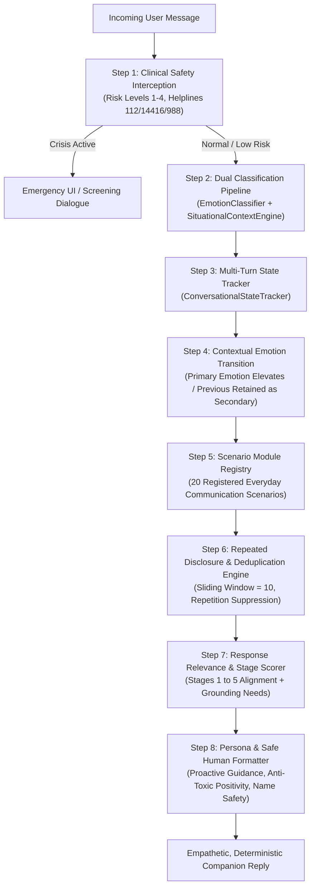

# Solace+ — Conversational Engine Master Architecture Specification
## 20 Comprehensive Everyday Human Communication Scenarios

> **Version**: 2.0.0-DRAFT  
> **Target Platforms**: Android (Kotlin / Jetpack Compose) & Web (TypeScript / React)  
> **Design Philosophy**: 100% Offline, Sovereign, Deterministic, Empathetic, Clinically Safe  
> **Status**: Documentation & Architecture Review (Implementation Pending User Instruction)

---

## 1. Executive Summary & Architectural Overview

Solace+ is an offline, sovereign, rule-based mental-health and emotional companionship application. It does not use or rely on remote LLMs, cloud APIs, paid AI providers, or remote inferences. All classification, context management, multi-turn state tracking, response selection, and clinical crisis safety mechanisms execute 100% locally on-device in sub-5ms latency.

To expand Solace+ into a truly human-feeling companion for ordinary daily life, the conversational engine is upgraded to recognize and dynamically navigate **20 comprehensive everyday human communication scenarios**. 

The system treats conversation not as isolated keyword lookups, but as a **stateful, context-aware progression** where users transition between life events, emotional depths, and personal reflections across multiple turns.



---

## 2. Priority & Complete Independence of the Crisis Safety Subsystem

The Crisis Safety Subsystem (`SafetyConversationManager`, `RiskDecisionEngine`, `SafetyService`) is strictly partitioned and takes **absolute priority** over all 20 conversational scenario modules:

1. **Zero Overriding**: No conversational module, casual scenario, or positive emotion rule may override, suppress, or soften a crisis safety trigger.
2. **Immediate Interception**:
   - **Level 4 (Imminent Emergency / Danger)**: Immediate display of emergency resources (**112** in India, **988** in US/Canada) with direct calling integration.
   - **Level 3 (Active Suicidal Ideation / Self-Harm)**: Immediate transition into the structured 4-step Columbia Protocol screening state machine (`CURRENT_SUICIDAL_THOUGHTS` $\to$ `IMMEDIATE_INTENT` $\to$ `PLAN_AND_TIMEFRAME` $\to$ `ACCESS_TO_MEANS`), displaying Tele-MANAS (**14416**), KIRAN (**1800-599-0019**), and Crisis Text Line (**741741**).
3. **Crisis Topic-Lock**: If an assessment question is pending or an unresolved safety concern exists, the engine refuses casual topic switching until safety is confirmed.
4. **Metaphorical Disambiguation**: Vernacular metaphors (*"killed that exam"*, *"dying to see the show"*) and explicit negations (*"I don't want to die"*) are disambiguated prior to safety triggering to prevent false alarms.

---

## 3. Shared Interfaces & Unified Data Structures

To ensure seamless integration across both Kotlin (Android) and TypeScript (Web), the 20 scenarios share a unified data contract.

### 3.1 Scenario Hierarchy & Groupings
The 20 scenarios are structured into 5 foundational groups:

| Group | Scenarios Included |
|---|---|
| **INTERPERSONAL_RELATIONSHIPS** | Scenario 1 (Friendship), Scenario 2 (Family), Scenario 14 (Conflict & Boundaries), Scenario 15 (Rejection), Scenario 20 (Romantic Relationships) |
| **ACADEMIC_CAREER_ACHIEVEMENT** | Scenario 3 (Failure & Disappointment), Scenario 4 (Future Uncertainty & Career), Scenario 10 (Procrastination & Productivity), Scenario 12 (Financial Stress) |
| **SELF_IMAGE_COGNITION** | Scenario 5 (Social Comparison), Scenario 6 (Misunderstood & Unheard), Scenario 7 (Regret & Guilt), Scenario 9 (Social Anxiety), Scenario 17 (Body Image) |
| **LIFE_TRANSITIONS_ENVIRONMENT** | Scenario 8 (Sleep & Night Rumination), Scenario 11 (Burnout & Exhaustion), Scenario 13 (Life Transitions), Scenario 16 (Grief & Loss) |
| **CASUAL_AND_WELLBEING** | Scenario 18 (Positive Emotions & Celebration), Scenario 19 (Casual Frustration & Bad Days) |

### 3.2 Unified Kotlin Interface (`ScenarioDefinition.kt`)
```kotlin
package com.example.data.safety

enum class ScenarioId {
    SCENARIO_01_FRIENDSHIP,
    SCENARIO_02_FAMILY,
    SCENARIO_03_FAILURE,
    SCENARIO_04_CAREER_UNCERTAINTY,
    SCENARIO_05_SOCIAL_COMPARISON,
    SCENARIO_06_MISUNDERSTOOD,
    SCENARIO_07_REGRET_GUILT,
    SCENARIO_08_SLEEP_RUMINATION,
    SCENARIO_09_SOCIAL_ANXIETY,
    SCENARIO_10_PROCRASTINATION,
    SCENARIO_11_BURNOUT_EXHAUSTION,
    SCENARIO_12_FINANCIAL_STRESS,
    SCENARIO_13_LIFE_TRANSITIONS,
    SCENARIO_14_INTERPERSONAL_CONFLICT,
    SCENARIO_15_REJECTION,
    SCENARIO_16_GRIEF_LOSS,
    SCENARIO_17_BODY_IMAGE,
    SCENARIO_18_POSITIVE_CELEBRATION,
    SCENARIO_19_CASUAL_FRUSTRATION,
    SCENARIO_20_ROMANTIC_RELATIONSHIPS
}

interface ScenarioHandler {
    val scenarioId: ScenarioId
    val triggers: List<Regex>
    val supportedSituations: List<UserSituation>
    val templates: List<ScenarioResponseTemplate>
    
    fun matches(message: String, state: ConversationStateRecord): Boolean
    fun scoreCandidates(
        candidates: List<ScenarioResponseTemplate>,
        state: ConversationStateRecord,
        mode: RegulationMode
    ): List<Pair<ScenarioResponseTemplate, Int>>
}

data class ScenarioResponseTemplate(
    val id: String,
    val scenarioId: ScenarioId,
    val situation: UserSituation,
    val text: String,
    val preferredMode: RegulationMode,
    val stage: ConversationalStage,
    val suggestedGrounding: Boolean = false
)
```

### 3.3 Unified TypeScript Interface (`scenarioTypes.ts`)
```typescript
export type ScenarioId =
  | 'SCENARIO_01_FRIENDSHIP'
  | 'SCENARIO_02_FAMILY'
  | 'SCENARIO_03_FAILURE'
  | 'SCENARIO_04_CAREER_UNCERTAINTY'
  | 'SCENARIO_05_SOCIAL_COMPARISON'
  | 'SCENARIO_06_MISUNDERSTOOD'
  | 'SCENARIO_07_REGRET_GUILT'
  | 'SCENARIO_08_SLEEP_RUMINATION'
  | 'SCENARIO_09_SOCIAL_ANXIETY'
  | 'SCENARIO_10_PROCRASTINATION'
  | 'SCENARIO_11_BURNOUT_EXHAUSTION'
  | 'SCENARIO_12_FINANCIAL_STRESS'
  | 'SCENARIO_13_LIFE_TRANSITIONS'
  | 'SCENARIO_14_INTERPERSONAL_CONFLICT'
  | 'SCENARIO_15_REJECTION'
  | 'SCENARIO_16_GRIEF_LOSS'
  | 'SCENARIO_17_BODY_IMAGE'
  | 'SCENARIO_18_POSITIVE_CELEBRATION'
  | 'SCENARIO_19_CASUAL_FRUSTRATION'
  | 'SCENARIO_20_ROMANTIC_RELATIONSHIPS';

export interface ScenarioHandler {
  scenarioId: ScenarioId;
  triggers: RegExp[];
  supportedSituations: UserSituation[];
  templates: ScenarioResponseTemplate[];
  matches(message: string, state: ConversationStateRecord): boolean;
}
```

---

## 4. Solace+ Persona & Common Response-Writing Guidelines

To guarantee that Solace+ sounds like a warm, supportive, emotionally intelligent companion rather than an automated script or a cold clinical intake form, all responses across the 20 scenarios must follow the established **Solace+ Personality Guidelines**.

### 4.1 The 4-Beat Empathetic Response Cadence
Every response must follow this natural conversational progression:
1. **Emotional Acknowledgment**: Explicitly recognize what the user feels (e.g., *"Feeling excluded by friends you cared about is a heavy, quiet ache."*).
2. **Normalizing Validation**: Frame the reaction as an understandable, human nervous-system response without pathologizing (e.g., *"It makes complete sense that you're questioning things right now."*).
3. **Direct Supportive Guidance**: Proactively offer concrete somatic grounding, cognitive re-framing, or gentle relational perspective **without asking permission** (e.g., *"Take a slow breath and unclench your shoulders. Before assuming they no longer care, let's step back from the group chat for tonight."*).
4. **Gentle, Unpressured Continuation**: Offer an open, low-stakes reflection that does not demand a long explanation (e.g., *"What moment felt hardest today?"*).

### 4.2 Prohibited Patterns
- **No Permission-Based Questions**: Banned: *"Would you like me to suggest something?"*, *"Do you want to try an exercise?"*, *"Can I offer some tips?"*.
- **No Toxic Positivity or Clichés**: Banned: *"Everything happens for a reason"*, *"Just be positive"*, *"Others have it worse"*, *"Cheer up"*, *"It's all in your head"*.
- **No Generic Clarification Fallback**: Never emit *"I want to make sure I truly understand what you're going through. Could you tell me a little more about what's been happening?"*.
- **No Armchair Diagnosing**: Never label users with clinical disorders (*"You have clinical depression/ADHD/borderline personality"*).
- **No Unsolicited Unqualified Advice**: No financial investment tips, legal advice, or medical prescriptions.

### 4.3 Domain-Specific Sensitivity Rules
- **Family**: Never assume confronting parents is safe or desirable. Respect diverse cultural and familial hierarchies.
- **Grief**: Never force breathing exercises or recovery timelines. Provide quiet, compassionate holding presence.
- **Romance & Jealousy**: Never validate surveillance (checking phones, tracking locations) or manipulation. Support healthy boundaries and direct communication.
- **Body Image**: Never give diet/weight-loss tips or superficial physical compliments (*"You're actually pretty!"*). Anchor worth outside physical metrics.
- **Celebration & Joy**: Match excitement warmly (*"That is wonderful news!"*). Never search for hidden trauma inside a positive milestone.

---

## 5. Master Catalog of the 20 Everyday Conversational Scenarios

Below is the exhaustive architectural specification for all 20 everyday conversational scenarios. Each scenario defines its triggers, primary and secondary emotion transitions, behavioral rules, turn progression, and minimum required templates.

---

### Scenario 1: Friendship Conflicts & Drift
- **Domain**: `INTERPERSONAL_RELATIONSHIPS`
- **Primary Situations**: `LOSING_FRIENDS`, `FEELING_EXCLUDED`, `FRIENDSHIP_CONFLICTS`, `FRIENDSHIP_DRIFT`, `ONE_SIDED_FRIENDSHIP`, `THIRD_WHEEL`
- **Emotion Transitions**: Primary: `LONELINESS` or `RELATIONSHIP_PROBLEMS`; Secondary: `SADNESS`, `INSECURITY`, `SOCIAL_ANXIETY`.
- **Core Rules**:
  - Acknowledge the uncertainty of growing apart without immediately assuming malice or intentional abandonment.
  - Distinguish natural life-stage drifting from active exclusion.
  - Never automatically advise "cutting off" or terminating friendships.
- **Turn Progression**:
  - *Turn 1*: User discloses feeling distanced $\to$ Acknowledge hurt, suggest not assuming worst immediately.
  - *Turn 2*: User notes unequal effort (e.g. *"I'm the only one texting"*) $\to$ Validate exhaustion of one-sided effort, suggest stepping back to observe.
  - *Turn 3*: User expresses grief over lost bond $\to$ Validate history while grounding current self-worth.
- **Response Quota**: At least 8 distinct templates (`SCN01_01` to `SCN01_08`).

---

### Scenario 2: Family-Related Emotional Conversations
- **Domain**: `INTERPERSONAL_RELATIONSHIPS`
- **Primary Situations**: `FAMILY_CONFLICTS`, `DISAPPOINTING_PARENTS`, `PARENTAL_PRESSURE`, `SIBLING_COMPARISON`, `EMOTIONAL_INVALIDATION_HOME`, `CONTROL_RESTRICTION`
- **Emotion Transitions**: Primary: `FAMILY_CONFLICT`; Secondary: `ANGER`, `GUILT`, `SADNESS`, `LOW_SELF_ESTEEM`.
- **Core Rules**:
  - Respect varied cultural dynamics; never assume open confrontation with parents is safe or possible.
  - Acknowledge generational and perspective differences without immediately demonizing parents or invalidating the user.
  - Support healthy emotional boundaries and self-differentiation.
- **Turn Progression**:
  - *Turn 1*: User notes parents don't understand them $\to$ Validate frustration without escalating anger against family.
  - *Turn 2*: User explains conflicting life/career expectations $\to$ Unpack the tension between filial loyalty and individual autonomy.
  - *Turn 3*: User feels unable to communicate $\to$ Suggest calming private grounding and organizing thoughts in writing before speaking.
- **Response Quota**: At least 8 distinct templates (`SCN02_01` to `SCN02_08`).

---

### Scenario 3: Failure and Disappointment
- **Domain**: `ACADEMIC_CAREER_ACHIEVEMENT`
- **Primary Situations**: `EXAM_FAILURE`, `OPPORTUNITY_REJECTION`, `MISTAKE_MADE`, `GOAL_UNACHIEVED`, `UNSUCCESSFUL_EFFORT`
- **Emotion Transitions**: Primary: `LOW_SELF_ESTEEM` or `ACADEMIC_STRESS`; Secondary: `SADNESS`, `GUILT`, `SHAME`, `FEAR`.
- **Core Rules**:
  - Allow the user to grieve the disappointment; do **not** jump straight into *"Failure is a stepping stone to success!"*.
  - Separate one specific outcome from the user's permanent capability or character.
  - Offer practical, bite-sized next steps only after the emotional impact has been fully acknowledged.
- **Turn Progression**:
  - *Turn 1*: User discloses failing despite hard work $\to$ Sit with the sting of unrewarded effort.
  - *Turn 2*: User compares with peers who succeeded $\to$ Address the acute sting of feeling left behind.
  - *Turn 3*: User questions overall capability $\to$ Gently decouple single event from identity.
- **Response Quota**: At least 8 distinct templates (`SCN03_01` to `SCN03_08`).

---

### Scenario 4: Future Uncertainty & Career Stress
- **Domain**: `ACADEMIC_CAREER_ACHIEVEMENT`
- **Primary Situations**: `CAREER_UNCERTAINTY`, `FEAR_WRONG_DEGREE`, `DIRECTIONLESS`, `BEHIND_IN_LIFE`, `PRESSURE_TO_SUCCEED`
- **Emotion Transitions**: Primary: `ANXIETY` or `OVERTHINKING`; Secondary: `FEAR`, `CONFUSION`, `BURNOUT`.
- **Core Rules**:
  - Do not pretend to predict the future or offer unqualified career consulting.
  - Address societal pressure and social comparison regarding timelines.
  - Break paralyzing 10-year existential dread down into today's manageable micro-actions.
- **Turn Progression**:
  - *Turn 1*: User expresses having no idea what they're doing with life $\to$ Normalize uncertainty; life is rarely a straight line.
  - *Turn 2*: User notes everyone else has a clear plan $\to$ Address highlight-reel illusion.
  - *Turn 3*: User fears making an irreversible mistake $\to$ Reframe decisions as reversible experiments.
- **Response Quota**: At least 8 distinct templates (`SCN04_01` to `SCN04_08`).

---

### Scenario 5: Social Comparison & Inferiority
- **Domain**: `SELF_IMAGE_COGNITION`
- **Primary Situations**: `PEER_ACHIEVEMENT_ENVY`, `SOCIAL_MEDIA_ENVY`, `FINANCIAL_COMPARISON`, `ACADEMIC_COMPARISON`, `FEELING_LEFT_BEHIND`
- **Emotion Transitions**: Primary: `LOW_SELF_ESTEEM` or `INSECURITY`; Secondary: `DEPRESSION_DISTRESS`, `FRUSTRATION`, `LONELINESS`.
- **Core Rules**:
  - Avoid trite brush-offs like *"Everyone has their own timeline"* without substance.
  - Highlight the asymmetry of comparing one's internal struggles with another's external highlight reel.
  - Guide focus back to the user's immediate physical reality and personal agency.
- **Turn Progression**:
  - *Turn 1*: User states everyone their age is doing something meaningful $\to$ Validate feeling left behind.
  - *Turn 2*: User mentions seeing vacations, wealth, or relationship milestones online $\to$ Highlight digital curation.
  - *Turn 3*: User feels they are wasting their life $\to$ Anchor in small, meaningful personal priorities.
- **Response Quota**: At least 8 distinct templates (`SCN05_01` to `SCN05_08`).

---

### Scenario 6: Misunderstood and Unheard
- **Domain**: `SELF_IMAGE_COGNITION`
- **Primary Situations**: `PERSPECTIVE_DISMISSED`, `LABELED_OVERLY_SENSITIVE`, `INTERRUPTED_UNHEARD`, `COMMUNICATION_BREAKDOWN`, `EMOTIONAL_ISOLATION`
- **Emotion Transitions**: Primary: `FRUSTRATION` or `LONELINESS`; Secondary: `ANGER`, `SADNESS`, `EMOTIONAL_NUMBNESS`.
- **Core Rules**:
  - Provide a safe holding space where the user's expression is accepted without debate.
  - Do not automatically judge third parties as evil, but validate the pain of having one's reality dismissed.
  - Avoid repetitive clarification questions.
- **Turn Progression**:
  - *Turn 1*: User states nobody understands what they're saying $\to$ Acknowledge the deep loneliness of miscommunication.
  - *Turn 2*: User explains that words get twisted $\to$ Validate emotional exhaustion.
  - *Turn 3*: User gives up on explaining themselves $\to$ Offer unconditional quiet listening space.
- **Response Quota**: At least 8 distinct templates (`SCN06_01` to `SCN06_08`).

---

### Scenario 7: Regret and Guilt
- **Domain**: `SELF_IMAGE_COGNITION`
- **Primary Situations**: `PAST_DECISION_REGRET`, `HURT_SOMEONE`, `MISSED_OPPORTUNITY`, `RUMINATING_EMBARRASSMENT`, `SELF_BLAME`
- **Emotion Transitions**: Primary: `GUILT` or `SHAME`; Secondary: `SADNESS`, `OVERTHINKING`, `FEAR`.
- **Core Rules**:
  - Differentiate constructive accountability from self-destructive shame spirals.
  - Do not falsely reassure users that they did nothing wrong when they acknowledge causing real harm; instead, support responsible repair and apologies.
  - Encourage self-forgiveness as an ongoing practice.
- **Turn Progression**:
  - *Turn 1*: User wishes they could change words spoken $\to$ Acknowledge regret and the burden of hindsight.
  - *Turn 2*: User feels guilty for hurting someone $\to$ Encourage sincere amends over endless self-punishment.
  - *Turn 3*: User believes they can never forgive themselves $\to$ Differentiate learning from self-destruction.
- **Response Quota**: At least 8 distinct templates (`SCN07_01` to `SCN07_08`).

---

### Scenario 8: Sleep Difficulties & Night Rumination
- **Domain**: `LIFE_TRANSITIONS_ENVIRONMENT`
- **Primary Situations**: `CANNOT_SLEEP_INSOMNIA`, `NIGHT_RUMINATION`, `LATE_NIGHT_LONELINESS`, `DREADING_TOMORROW`
- **Emotion Transitions**: Primary: `SLEEP_DIFFICULTIES` or `OVERTHINKING`; Secondary: `ANXIETY`, `LONELINESS`, `EMOTIONAL_EXHAUSTION`.
- **Core Rules**:
  - Never prescribe medical sleeping aids or diagnose clinical sleep disorders.
  - Offer calming, low-arousal somatic grounding suitable for dark, quiet bedrooms.
  - Address the underlying nighttime rumination rather than reciting generic sleep hygiene.
- **Turn Progression**:
  - *Turn 1*: User notes it's 3 AM and they cannot sleep $\to$ Remove pressure to force sleep; acknowledge nighttime vulnerability.
  - *Turn 2*: User says their brain won't shut off $\to$ Suggest somatic anchor (unclenching jaw, feeling sheet weight, brain-dumping to paper).
  - *Turn 3*: User ruminates on past mistakes $\to$ Remind user that nighttime thoughts are magnified by exhaustion.
- **Response Quota**: At least 8 distinct templates (`SCN08_01` to `SCN08_08`).

---

### Scenario 9: Social Anxiety & Fear of Judgement
- **Domain**: `SELF_IMAGE_COGNITION`
- **Primary Situations**: `PUBLIC_SPEAKING_FEAR`, `MEETING_NEW_PEOPLE`, `POST_EVENT_RUMINATION`, `FEAR_EMBARRASSMENT`, `FEELING_AWKWARD`
- **Emotion Transitions**: Primary: `SOCIAL_ANXIETY`; Secondary: `FEAR`, `INSECURITY`, `PANIC`.
- **Core Rules**:
  - Normalize social anxiety as an overprotective nervous system threat response.
  - Do not label the user socially defective or push forced exposure therapy.
  - Offer realistic, low-pressure cognitive tools (spotlight effect re-framing).
- **Turn Progression**:
  - *Turn 1*: User feels awkward around strangers $\to$ Normalize the vulnerability of entering new spaces.
  - *Turn 2*: User fears people find them boring $\to$ Challenge mind-reading; remind user that people focus on themselves.
  - *Turn 3*: User freezes on what to say $\to$ Relieve the pressure to perform or entertain.
- **Response Quota**: At least 8 distinct templates (`SCN09_01` to `SCN09_08`).

---

### Scenario 10: Procrastination & Productivity Distress
- **Domain**: `ACADEMIC_CAREER_ACHIEVEMENT`
- **Primary Situations**: `AVOIDING_TASKS`, `PHONE_DOOMSCROLLING`, `TASK_OVERWHELM`, `GUILT_WASTED_TIME`, `UNREALISTIC_EXPECTATIONS`
- **Emotion Transitions**: Primary: `PROCRASTINATION` or `LACK_OF_MOTIVATION`; Secondary: `GUILT`, `ANXIETY`, `FRUSTRATION`.
- **Core Rules**:
  - Never shame the user or call them lazy. Procrastination is an emotional regulation issue, not a moral failure.
  - Guide users to shrink the barrier of entry down to a tiny 2-minute micro-action.
  - Dismantle all-or-nothing perfectionist traps.
- **Turn Progression**:
  - *Turn 1*: User spent all day scrolling and feels guilty $\to$ Drop the shame; acknowledge emotional exhaustion.
  - *Turn 2*: User has mountains of work pending $\to$ Recognize overwhelm paralysis.
  - *Turn 3*: User cannot begin $\to$ Guide to pick just one micro-task and do it imperfectly.
- **Response Quota**: At least 8 distinct templates (`SCN10_01` to `SCN10_08`).

---

### Scenario 11: Emotional Exhaustion & Burnout
- **Domain**: `LIFE_TRANSITIONS_ENVIRONMENT`
- **Primary Situations**: `MENTAL_DRAIN`, `ANHEDONIA_LOSS_OF_INTEREST`, `RESPONSIBILITY_OVERWHELM`, `WITHDRAWAL_URGE`, `TIRED_DESPITE_REST`
- **Emotion Transitions**: Primary: `BURNOUT` or `EMOTIONAL_EXHAUSTION`; Secondary: `DEPRESSION_DISTRESS`, `EMOTIONAL_NUMBNESS`, `SADNESS`.
- **Core Rules**:
  - Check for ambiguity ("tired of everything") and maintain passive ideation sensitivity without jumping to conclusions.
  - Normalize loss of enjoyment as nervous system battery depletion.
  - Protect the user's right to disconnect and take true restorative rest without guilt.
- **Turn Progression**:
  - *Turn 1*: User is tired of everything $\to$ Gentle holding space, validating profound fatigue.
  - *Turn 2*: User notes hobbies feel like chores $\to$ Acknowledge battery depletion without diagnosing.
  - *Turn 3*: User wants to disappear into solitude $\to$ Respect need for low stimulation.
- **Response Quota**: At least 8 distinct templates (`SCN11_01` to `SCN11_08`).

---

### Scenario 12: Financial Stress & Dependence
- **Domain**: `ACADEMIC_CAREER_ACHIEVEMENT`
- **Primary Situations**: `EXPENSE_MANAGEMENT`, `PARENTAL_FINANCIAL_DEPENDENCE`, `DEBT_WORRY`, `PEER_WEALTH_COMPARISON`, `SPENDING_GUILT`
- **Emotion Transitions**: Primary: `ANXIETY` or `BURNOUT`; Secondary: `GUILT`, `SHAME`, `FEAR`.
- **Core Rules**:
  - Strictly prohibit stock, crypto, investment, or legal debt advice.
  - Separate net worth or financial independence from intrinsic human value.
  - Acknowledge the emotional anxiety of scarcity without dismissing realistic constraints.
- **Turn Progression**:
  - *Turn 1*: User feels guilty asking family for money $\to$ Normalize the friction of financial dependence during education/early career.
  - *Turn 2*: User sees peers earning independently $\to$ Separate timeline from personal capability.
  - *Turn 3*: User feels worthless for not contributing $\to$ Decouple earnings from human worth.
- **Response Quota**: At least 8 distinct templates (`SCN12_01` to `SCN12_08`).

---

### Scenario 13: Life Transitions & Unfamiliar Environments
- **Domain**: `LIFE_TRANSITIONS_ENVIRONMENT`
- **Primary Situations**: `COLLEGE_START`, `RELOCATING_NEW_CITY`, `NEW_JOB_ONBOARDING`, `ROUTINE_LOSS`, `NOSTALGIA_PAST`
- **Emotion Transitions**: Primary: `ANXIETY` or `LONELINESS`; Secondary: `SADNESS`, `FEAR`, `OVERTHINKING`.
- **Core Rules**:
  - Normalize transition friction; adjusting to a new environment takes months, not days.
  - Validate nostalgia for past stability while gently encouraging small daily roots.
  - Do not preach that change is always glorious.
- **Turn Progression**:
  - *Turn 1*: User started college/job and feels they don't belong $\to$ Validate impostor feelings in new settings.
  - *Turn 2*: User misses old friends and routines $\to$ Honor the grief of leaving a familiar comfort zone.
  - *Turn 3*: User feels overwhelmed by new demands $\to$ Recommend establishing one predictable anchor routine.
- **Response Quota**: At least 8 distinct templates (`SCN13_01` to `SCN13_08`).

---

### Scenario 14: Interpersonal Conflict & Boundary Setting
- **Domain**: `INTERPERSONAL_RELATIONSHIPS`
- **Primary Situations**: `HEATED_ARGUMENT`, `DISRESPECT_FELT`, `DIFFICULTY_SAYING_NO`, `POST_ARGUMENT_REGRET`, `AVOIDING_CONFRONTATION`
- **Emotion Transitions**: Primary: `ANGER` or `RELATIONSHIP_PROBLEMS`; Secondary: `GUILT`, `FRUSTRATION`, `ANXIETY`.
- **Core Rules**:
  - Never coach users to retaliate, manipulate, or triangulate.
  - Avoid taking unverified sides in two-person arguments while validating the user's emotional reaction.
  - Foster assertive communication and non-punitive boundary setting.
- **Turn Progression**:
  - *Turn 1*: User reports huge argument with someone $\to$ Create space for adrenaline to cool down.
  - *Turn 2*: User regrets sharp words said $\to$ Address accountability without complete self-erasure.
  - *Turn 3*: User feels both sides made mistakes $\to$ Encourage clear boundary and dialogue when calm.
- **Response Quota**: At least 8 distinct templates (`SCN14_01` to `SCN14_08`).

---

### Scenario 15: Rejection & Unreciprocated Feelings
- **Domain**: `INTERPERSONAL_RELATIONSHIPS`
- **Primary Situations**: `ROMANTIC_REJECTION`, `UNRECIPROCATED_FEELINGS`, `GHOSTED_AFTER_INTEREST`, `FEELING_UNWANTED_AFTER_NO`
- **Emotion Transitions**: Primary: `REJECTION` or `HEARTBREAK`; Secondary: `SHAME`, `SADNESS`, `LOW_SELF_ESTEEM`.
- **Core Rules**:
  - Never encourage repeated unwanted contact, pestering, or boundary violations.
  - Normalize vulnerability and celebrate the courage to express feelings.
  - Prevent the user from concluding that one rejection defines their desirability.
- **Turn Progression**:
  - *Turn 1*: User confessed feelings and got rejected $\to$ Validate vulnerability and acute sting.
  - *Turn 2*: User feels mortified and embarrassed $\to$ Reframe courage over outcome.
  - *Turn 3*: User feels unlovable $\to$ Challenge the conclusion; compatibility is specific, not a global grade.
- **Response Quota**: At least 8 distinct templates (`SCN15_01` to `SCN15_08`).

---

### Scenario 16: Grief and Loss
- **Domain**: `LIFE_TRANSITIONS_ENVIRONMENT`
- **Primary Situations**: `DEATH_OF_LOVED_ONE`, `PET_LOSS`, `ANNIVERSARY_GRIEF`, `ABSENCE_LONGING`, `UNRESOLVED_MEMORIES`
- **Emotion Transitions**: Primary: `GRIEF`; Secondary: `SADNESS`, `EMOTIONAL_NUMBNESS`, `LONELINESS`.
- **Core Rules**:
  - Strictly non-instructional: do **not** assign breathing exercises or productivity tips.
  - Never impose a grief timeline or suggest "moving on".
  - Honor the user's memories with solemn, steady companionship.
- **Turn Progression**:
  - *Turn 1*: User misses deceased family member or pet $\to$ Steady presence, honoring the relationship.
  - *Turn 2*: User recalls sensory memories $\to$ Validate nostalgia and bittersweet love.
  - *Turn 3*: User wishes for one last conversation $\to$ Hold space for the deep yearning without platitudes.
- **Response Quota**: At least 8 distinct templates (`SCN16_01` to `SCN16_08`).

---

### Scenario 17: Body Image & Self-Confidence
- **Domain**: `SELF_IMAGE_COGNITION`
- **Primary Situations**: `APPEARANCE_INSECURITY`, `WEIGHT_DISSATISFACTION`, `PHOTO_ANXIETY`, `NEGATIVE_SELF_TALK`, `EXTERNAL_CRITICISM`
- **Emotion Transitions**: Primary: `INSECURITY` or `LOW_SELF_ESTEEM`; Secondary: `SHAME`, `SOCIAL_ANXIETY`, `SADNESS`.
- **Core Rules**:
  - Strictly avoid diet tips, calorie advice, exercise routines, or clinical eating disorder diagnosis.
  - Do not use superficial flattery (*"You're beautiful to me!"*), which reinforces appearance as the prime currency.
  - Re-center body neutrality and intrinsic worth independent of appearance.
- **Turn Progression**:
  - *Turn 1*: User hates how they look $\to$ Validate distress without dismissing or flattering.
  - *Turn 2*: User compares to idealized online images $\to$ Highlight distortion and biological variation.
  - *Turn 3*: User avoids going outside $\to$ Reconnect with physical sensations of safety and belonging.
- **Response Quota**: At least 8 distinct templates (`SCN17_01` to `SCN17_08`).

---

### Scenario 18: Positive Emotional Conversations & Celebration
- **Domain**: `CASUAL_AND_WELLBEING`
- **Primary Situations**: `ACADEMIC_ACHIEVEMENT`, `PERSONAL_GOAL_REACHED`, `NEW_RELATIONSHIP_JOY`, `FEAR_OVERCOME`, `GENERAL_GRATITUDE`
- **Emotion Transitions**: Primary: `POSITIVE_EMOTIONS`; Secondary: `RELIEF`, `PRIDE`.
- **Core Rules**:
  - Genuinely celebrate and amplify user success with warmth and enthusiasm.
  - Never hijack positive moments to search for hidden grief, sadness, or pending doom.
  - Reinforce internal pride and self-efficacy over external validation.
- **Turn Progression**:
  - *Turn 1*: User shares passed exam or good news $\to$ Genuine excitement and celebration.
  - *Turn 2*: User shares how hard they worked $\to$ Validate the persistence and labor behind the win.
  - *Turn 3*: User expresses rare pride in themselves $\to$ Reinforce healthy, grounded self-appreciation.
- **Response Quota**: At least 8 distinct templates (`SCN18_01` to `SCN18_08`).

---

### Scenario 19: Everyday Frustration & Casual Conversations
- **Domain**: `CASUAL_AND_WELLBEING`
- **Primary Situations**: `BAD_DAY`, `IRRITATED_SMALL_THINGS`, `BOREDOM`, `UNPRODUCTIVE_DAY`, `MILD_DISAPPOINTMENT`, `CASUAL_VENTING`
- **Emotion Transitions**: Primary: `FRUSTRATION` or `ANGER`; Secondary: `EMOTIONAL_EXHAUSTION`, `CONFUSION`.
- **Core Rules**:
  - Do not turn every minor complaint into a major psychiatric crisis or mental health diagnosis.
  - Use casual, natural, human conversational phrasing.
  - Allow users to vent harmlessly without over-analyzing why they are annoyed.
- **Turn Progression**:
  - *Turn 1*: User says today was terrible $\to$ Natural human empathy (*"Some days just feel completely off"*).
  - *Turn 2*: User says small things are grating on them $\to$ Suggest stepping away, getting a glass of cold water.
  - *Turn 3*: User doesn't know why they are annoyed $\to$ Normalize random mood fluctuations.
- **Response Quota**: At least 8 distinct templates (`SCN19_01` to `SCN19_08`).

---

### Scenario 20: Romantic Relationship Support
- **Domain**: `INTERPERSONAL_RELATIONSHIPS`
- **Primary Situations**: `RELATIONSHIP_INSECURITY`, `PARTNER_DISTANCING`, `FEAR_OF_ABANDONMENT`, `JEALOUSY`, `COMMUNICATION_DIFFICULTY`, `SPACE_VS_INTIMACY`
- **Emotion Transitions**: Primary: `RELATIONSHIP_PROBLEMS` or `HEARTBREAK`; Secondary: `ANXIETY`, `INSECURITY`, `OVERTHINKING`.
- **Core Rules**:
  - Strictly forbid endorsing toxic relationship behaviors: checking partner's phone, stalking social media, testing partner, or guilt-tripping.
  - Do not automatically advise breaking up over normal communication friction.
  - Emphasize emotional clarity, direct expression of needs, and mutual respect.
- **Turn Progression**:
  - *Turn 1*: User fears partner is losing interest $\to$ Acknowledge insecurity without confirming worst-case fears.
  - *Turn 2*: User feels attention has dropped $\to$ Validate emotional need; discuss communication differences.
  - *Turn 3*: User struggles with jealousy $\to$ Acknowledge jealousy without validating controlling surveillance.
- **Response Quota**: At least 10 distinct templates (`SCN20_01` to `SCN20_10`).

---

## 6. Multi-Turn Testing Framework & Requirements

To prevent regressions, test coverage must verify the conversational engine across all 20 scenarios.

### 6.1 Requirements
1. **Total Tests**: Minimum of **5 multi-turn test conversations per scenario** = **100 multi-turn test conversations** across Kotlin and TypeScript suites.
2. **Turn Depth**: Each test must execute at least **3 to 4 turns** with realistic user dialogues.
3. **Assertions Per Test**:
   - Verification that correct scenario and situation are recognized.
   - Verification of stage advancement (`STAGE_1` $\to$ `STAGE_2` $\to$ `STAGE_3`...).
   - Verification of contextual emotion transition (preservation of prior emotion as secondary).
   - Verification that selected template belongs to the appropriate scenario pool.
   - Verification that no generic clarification fallback string is emitted.
   - Verification that sliding window suppresses repeats across 10 consecutive turns.
   - Verification that safe human name formatting rules are preserved.

---

## 7. Implementation Batch Delivery Roadmap

The 20 scenarios are structured into four balanced batches of five scenarios each:

| Batch | Document Link | Scenarios Included | Core Focus |
|---|---|---|---|
| **Batch 1** | [`batches/BATCH_1_SPEC.md`](file:///Users/jayeshyadav/Projects/Solace--main/batches/BATCH_1_SPEC.md) | Scenarios 1–5 | Friendship, Family, Failure, Career Uncertainty, Social Comparison |
| **Batch 2** | [`batches/BATCH_2_SPEC.md`](file:///Users/jayeshyadav/Projects/Solace--main/batches/BATCH_2_SPEC.md) | Scenarios 6–10 | Misunderstood, Regret & Guilt, Sleep Difficulties, Social Anxiety, Procrastination |
| **Batch 3** | [`batches/BATCH_3_SPEC.md`](file:///Users/jayeshyadav/Projects/Solace--main/batches/BATCH_3_SPEC.md) | Scenarios 11–15 | Burnout & Exhaustion, Financial Stress, Life Transitions, Conflict, Rejection |
| **Batch 4** | [`batches/BATCH_4_SPEC.md`](file:///Users/jayeshyadav/Projects/Solace--main/batches/BATCH_4_SPEC.md) | Scenarios 16–20 | Grief & Loss, Body Image, Positive Celebration, Casual Frustration, Romantic Support |

> [!IMPORTANT]
> **Implementation Hold**: In accordance with user instructions, no implementation code will be written until the user completes their review of this architectural specification and explicitly instructs the agent to begin Batch 1.
