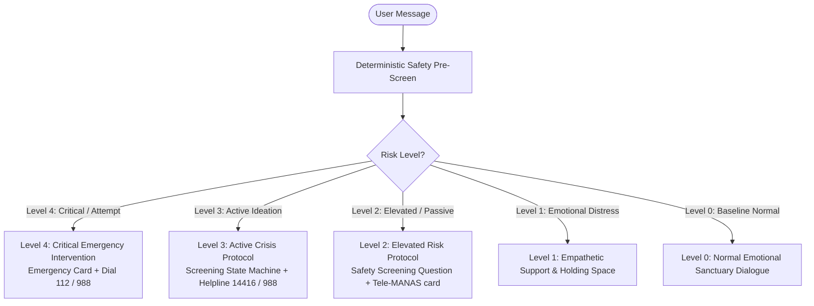
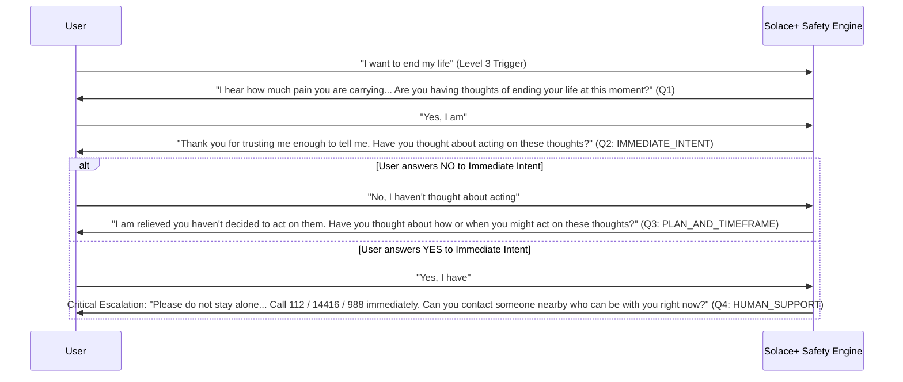

# Solace+ — Crisis Safety Protocol & Escalation Specification

---

## 1. Safety Priority Directive

In Solace+, clinical safety holds **absolute priority over all generative and emotional support conversational systems**. The Crisis Safety Engine operates as an autonomous gatekeeper that evaluates every message before normal classification, conversational mode selection, or response rendering can occur.

---

## 2. Clinical Risk Escalation Hierarchy (Levels 0 – 4)

### LEVEL 0 — Normal Emotional Expression
- **Definition**: Routine conversational interactions, light venting, positive feelings, or social check-ins.
- **Examples**: *"I'm tired after work", "Having a quiet morning", "Doing pretty good today"*.
- **Action**: Standard rule-based emotional companion dialogue.

### LEVEL 1 — Significant Emotional Distress
- **Definition**: Pronounced distress, grief, acute frustration, or exhaustion without suicidal ideation or self-harm.
- **Examples**: *"I had a terrible day", "I feel so heartbroken", "Everything is falling apart at school"*.
- **Action**: Empathetic emotional acknowledgment, validation, reflective inquiry, somatic grounding cues. No emergency alarms.

### LEVEL 2 — Passive Suicidal Ideation & Burdensomeness
- **Definition**: Indirect expressions of wanting to disappear, feeling like a burden, or wishing one were not alive.
- **Examples**: *"Everyone would be better off without me", "I wish I could go to sleep and never wake up", "I don't want to exist anymore"*.
- **Action**: Activates sensitive safety screening conversation. Asks directly and calmly whether the user is thinking about suicide or hurting themselves (`CURRENT_SUICIDAL_THOUGHTS`). Displays the gentle Mental Health Support Card (Tele-MANAS / 988).

### LEVEL 3 — Active Suicidal Ideation
- **Definition**: Direct statements of suicidal intent or thoughts of taking one's life without confirmed immediate timeline or accessible means.
- **Examples**: *"I want to kill myself", "I am having suicidal thoughts", "I want to end my life"*.
- **Action**: Immediately interrupts ordinary dialogue. Uses dedicated safety-reviewed crisis response. Initiates the multi-turn assessment progression. Provides verified emergency and 24/7 crisis helplines.

### LEVEL 4 — Immediate Physical Danger & Critical Emergency
- **Definition**: Active suicide attempt in progress, explicit near-term plan with means and timeframe (*"tonight"*, *"right now"*, *"swallowed pills"*), or immediate violence/stalking.
- **Examples**: *"I took all my pills", "I am going to end my life tonight", "Someone broke in and is attacking me"*.
- **Action**: Full emergency intervention. Displays modal with direct click-to-call **112** (India) / **988** (US/Canada). Urges the user to call emergency services immediately or go to the nearest emergency department.

---

## 3. Progressive Safety Questioning State Machine

When a user triggers Level 2 or Level 3, the engine initiates a deterministic sequence of assessment questions. An answered question is never repeated, and each answer is compassionately acknowledged before presenting the next assessment step:

---

## 4. Prevention of Topic Switching During Active Crisis (Topic Lock)

A critical safety vulnerability in conventional chatbots is that a user in acute crisis can say *"Let's talk about movies"* or *"Write me a poem"*, causing the system to casually drop the suicide alert.

**Solace+ Invariant**: If a conversation session has an unresolved safety concern or is in active crisis:
1. The user cannot casually clear or downgrade the safety state by changing the subject.
2. The engine executes a compassionate **Topic Lock**:
   *"I hear you, and we can definitely talk about that, but first I need to make sure you are safe and supported right now. Are you safe in this moment?"*
3. Only an explicit, unambiguous confirmation of safety or physical presence of human support permits de-escalation back to standard dialogue.

---

## 5. Verified Emergency Helpline Directory

| Country / Region | Resource Name | Contact Number | Operating Hours | Type |
|---|---|---|---|---|
| **India** | National Emergency Response Support System (ERSS) | **112** | 24/7 Toll-Free | Police, Ambulance, Fire |
| **India** | Tele-MANAS (Ministry of Health & Family Welfare) | **14416** / **1800-891-4416** | 24/7 Toll-Free | Comprehensive Mental Health Support in 20+ Languages |
| **India** | KIRAN Mental Health Helpline | **1800-599-0019** | 24/7 Toll-Free | Psychological First Aid & De-escalation |
| **US / Canada** | 988 Suicide & Crisis Lifeline | **988** | 24/7 Toll-Free | Free, Confidential Call & Text Support |
| **Global** | Crisis Text Line | Text **HOME** to **741741** | 24/7 Free SMS | SMS-based Crisis Support |
