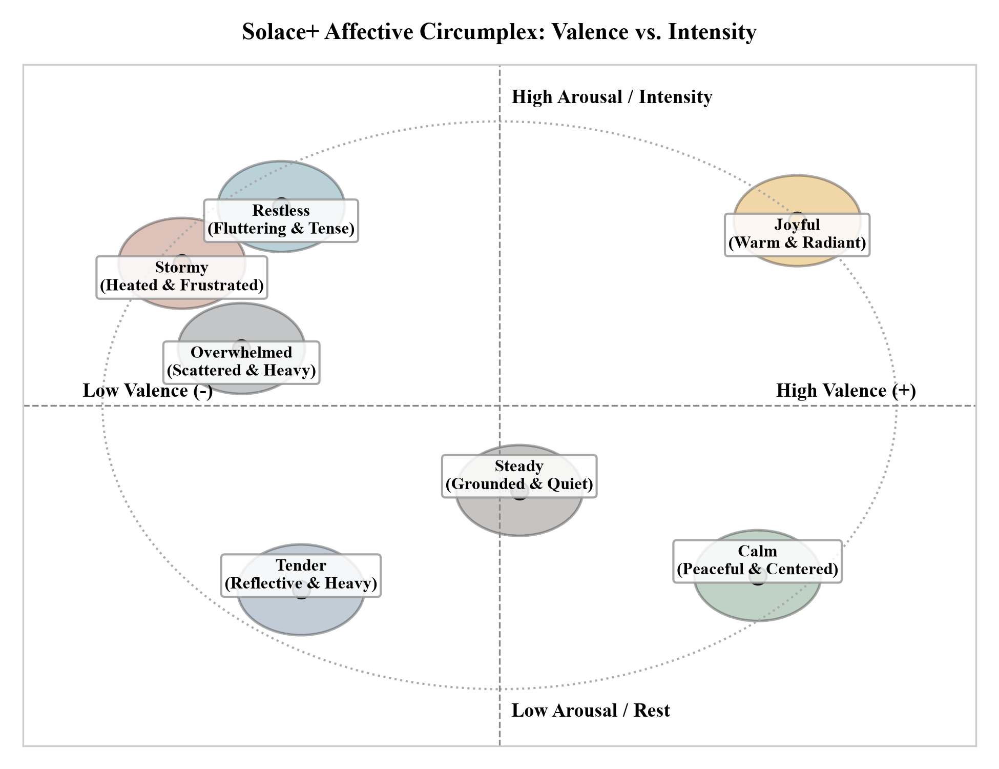

# Chapter 1

# Introduction

## 1.1 Introduction & Motivation

The human mind and autonomic nervous system exist in an intricate, continuous dialogue with the external environment. In contemporary society, accelerating digital connectivity, relentless information velocity, workplace precarity, and social isolation have produced an unprecedented surge in mental health vulnerabilities. According to epidemiological reports by the World Health Organization (WHO), over one billion people globally navigate mental disorders, with anxiety and depressive conditions ranking among the leading causes of disability. In developing nations such as India, the treatment gap for common mental health conditions exceeds 70%, driven by an acute scarcity of clinical psychiatrists, geographic disparities, economic barriers, and pervasive social stigmatization.

Traditional approaches to psychological intervention rely heavily upon in-person clinical consultations and outpatient psychiatric evaluations. While essential, these traditional avenues face fundamental scalability constraints. The vast majority of individuals suffering from transient emotional distress, workplace burnout, loneliness, or autonomic nervous system dysregulation neither require nor have access to formal psychiatric hospitalization. Instead, what is urgently needed are daily, accessible, low-friction digital tools capable of facilitating emotional self-awareness, somatic stabilization, and unhurried psychological holding space.

The rapid proliferation of smartphones has catalyzed the emergence of digital mental health applications (mHealth). However, an objective architectural evaluation of mainstream wellness platforms (e.g., Headspace, Calm, Duolingo-style health tools) reveals profound design contradictions. Modern commercial applications almost universally deploy extractive gamification mechanisms—such as mandatory daily streaks, numerical mood scores, public leaderboards, and guilt-inducing push notifications. While effective at maximizing commercial daily active user (DAU) metrics, these mechanisms trigger acute performance anxiety and shame when dysregulated or exhausted users fail to maintain streaks. Users who need solace the most are actively repelled by punitive gamification.

Furthermore, with the advent of generative Artificial Intelligence (AI) and Large Language Models (LLMs), numerous conversational mental health agents have entered the market. While LLMs offer extraordinary natural language fluency, unconstrained stochastic models present critical clinical vulnerabilities:
1. **Hallucination and Prescriptive Sycophancy:** In the absence of strict system guardrails, general LLMs frequently fabricate clinical advice, diagnose psychiatric conditions without empirical authority, or offer patronizing, generic platitudes.
2. **Catastrophic Failure in Crisis Triage:** When confronted with explicit suicidal ideation or self-harm disclosures, general LLMs risk offering dismissive or invalidating responses, failing to supply actionable, life-saving emergency helplines.
3. **Pervasive Privacy Invasions:** Intimate personal journals and conversational disclosures are routinely harvested, processed on remote commercial cloud clusters, and shared with third-party behavioral advertising brokers.
4. **Neglect of Somatic Physiology:** Mainstream digital apps focus almost exclusively on cognitive talk therapy, ignoring the neurobiological reality that autonomic dysregulation (anxiety, panic, shutdown) requires bottom-up physiological stabilization before top-down cognitive reframing can succeed.

*Figure 1.1.1: Solace+ Affective Circumplex: Mapping 7-State Mood Taxonomy across Valence and Arousal Dimensions*

To resolve these foundational challenges, this research introduces **Solace+** (`solace-android`), an emotionally intelligent native Android mental wellness companion and somatic regulation platform. Solace+ is engineered from the ground up as a gentle, private digital sanctuary. It rejects streaks, scores, and gamification in favor of unconditional holding space, polyvagal-informed somatic pacing, and dynamic atmospheric interface responsiveness.

The platform introduces a **Mood-Responsive Atmospheric Canvas** that dynamically morphs surface luminescence, container tints, and motion kinetics across seven affective states (*Joyful, Calm, Steady, Tender, Restless, Stormy, Overwhelmed*), providing instant visual validation of the user's emotional state. Beneath this canvas operates a **Hybrid Intelligence Architecture** combining Google Gemini REST API endpoints (`gemini-1.5-flash`, `gemini-2.0-flash`, `gemini-2.5-flash`) with an on-device **Adaptive Local Sanctuary Dialogue Engine** that delivers warm, non-repetitive therapeutic reflections even when offline. To safeguard vulnerable users, Solace+ embeds a **Deterministic 4-Tier Mental Health Risk Decision & Escalation Subsystem** (`RiskDecisionEngine`, `EscalationManager`, `ContextAnalyzer`) that systematically intercepts distress, passive ideation, and acute crisis signals, overriding generative AI with verified national helplines (**Tele-MANAS 14416**, **112 Emergency**). Backed by a strict **zero-knowledge local-first data architecture** (Room SQLite Database v3), Solace+ guarantees absolute privacy for intimate personal reflections.

---

## 1.2 Literature Review

Recent research in computer science, biomedical engineering, and clinical psychology has investigated diverse methodologies for conversational mental health agents, affective computing, autonomic nervous system regulation, and safety triage. The following is a detailed summary of notable academic contributions:

**Kathleen Kara Fitzpatrick, Alison Darcy, and Molly Vierhile (2017) [1]** investigated delivering Cognitive Behavior Therapy (CBT) to young adults using a fully automated conversational agent named Woebot in a randomized controlled trial published in *JMIR Mental Health*. The study randomized 70 college-aged individuals with symptoms of depression and anxiety into either an automated conversational agent group or an information-only control group over two weeks. Participants in the conversational agent group showed a statistically significant reduction in depression scores ($F = 6.47, P = .01$) on the PHQ-9. The research proved that automated text-based agents can form a therapeutic alliance and provide accessible psychological support. However, Woebot relied on rigid decision-tree rule sets that lacked organic dialogue nuance, and operated inside a third-party social messaging ecosystem that posed severe data privacy hazards.

**Becky Inkster, Shubhankar Sarda, and Vinod Subramanian (2018) [2]** evaluated an empathy-driven conversational AI agent named Wysa for digital mental well-being in a naturalistic mixed-methods study published in *JMIR mHealth and uHealth*. The authors analyzed anonymous text conversations from real-world adult users to investigate whether users could establish an emotional bond with an artificial entity. The study revealed significant user engagement (an average of 16 sessions per user) and significant self-reported improvements in perceived coping. Qualitative findings demonstrated that users appreciated the non-judgmental, unhurried space provided by an AI persona. However, Wysa’s mobile interface maintained a static aesthetic canvas regardless of user affect and lacked deep somatic pacing.

**Stephen W. Porges (2022) [3]** synthesized the neurobiological foundations of the Polyvagal Theory in *Frontiers in Integrative Neuroscience*, outlining the science of safety and autonomic regulation. Porges demonstrated that the autonomic nervous system is organized hierarchically: the phylogenetically newer ventral vagal complex regulates physiological states of safety, social engagement, and metabolic calm; the sympathetic nervous system governs active mobilization, fight-or-flight arousal, and anxious restlessness; and the unmyelinated dorsal vagal system triggers metabolic shutdown, numbness, and depressive immobilization. Crucially, Porges proved that cognitive interventions fail when the nervous system is locked in sympathetic or dorsal states. True emotional regulation requires "bottom-up" physiological cues of safety—such as paced exhalation, vocal resonance, and muscle relaxation.

**Sylvain Laborde, Emma Mosley, and Julian F. Thayer (2017) [4]** established methodological recommendations for measuring heart rate variability (HRV) and cardiac vagal tone in psychophysiological research in *Frontiers in Psychology*. Their meta-analysis and experimental protocols demonstrated that slow-paced respiration (specifically at 0.1 Hz, or approximately 6 breaths per minute with equalized 4-second phases) maximizes respiratory sinus arrhythmia (RSA), directly stimulates the vagus nerve, and rapidly down-regulates sympathetic hyperarousal. These findings establish empirical physiological justification for incorporating paced respiration routines directly into affective software interfaces.

**Adam S. Miner, Arnold Milstein, Stephen Schueller et al. (2016) [5]** evaluated smartphone-based conversational agents (Siri, Google Now, S Voice, Cortana) in response to questions about mental health, interpersonal violence, and physical emergencies in *JAMA Internal Medicine*. Presenting standardized clinical vignettes across mobile platforms, the authors found that mobile assistants exhibited inconsistent, incomplete, and sometimes dangerous responses. Many assistants offered web searches, jokes, or completely failed to recognize suicidal ideation. The authors concluded that conversational software must incorporate dedicated clinical safety interception rather than treating health disclosures as generic search queries.

**Ashish Sharma, Inna Wanyin Lin, Adam S. Miner, David C. Atkins, and Tim Althoff (2023) [6]** examined human-AI collaboration for empathic conversations in text-based peer-to-peer mental health support in *Nature Machine Intelligence*. The authors demonstrated that integrating AI-driven empathic rewriting suggestions significantly increased expressed empathy by 19.6% overall and by 38.8% among supporters who previously struggled with empathy. The study formalized linguistic components of empathy in text: emotional validation, collaborative exploration, and non-judgmental interpretation.

**Stevie Chancellor and Munmun De Choudhury (2020) [7]** provided a critical review of predictive machine learning techniques for mental health status on social media in *npj Digital Medicine*. Analyzing 75 peer-reviewed papers spanning SVMs, Random Forests, LSTMs, and psycholinguistic classifiers, the authors highlighted widespread methodological vulnerabilities: algorithmic bias, lack of clinical construct validity, and acute vulnerability to figurative language. Specifically, keyword-only classifiers produce unacceptably high false-positive rates on common colloquialisms (e.g., "I'm dying of laughter", "this deadline is killing me"), demonstrating the absolute necessity of contextual and linguistic modifier parsing.

**Mark Matthews and Gavin Doherty (2011) [8]** designed and deployed a mobile mood-tracking system for adolescent psychotherapy in *ACM CHI '11*. The authors found that visualizing emotional trajectories over time significantly enhanced reflective self-awareness. However, complex psychiatric forms caused steep user drop-off; low-friction, intuitive input mechanisms and visual feedback were critical to maintaining user engagement without creating cognitive burden.

**John Torous, Sandra Bucci, Imogen H. Bell et al. (2021) [9]** analyzed the growing field of digital psychiatry, evaluating current evidence for smartphone apps, chatbots, and digital therapeutics in *World Psychiatry*. While acknowledging the potential of mobile apps to reduce mild-to-moderate depression and anxiety, the authors documented that over 90% of real-world users abandon wellness apps within two weeks. The primary drivers of attrition were intrusive gamification (punitive streaks), lack of transparency regarding data harvesting, and clinical sterile designs that felt transactional.

**Vaibhav A. Narayan et al. and Timothy Bickmore (2019) [10]** investigated patient and consumer safety risks when utilizing commercial conversational assistants for medical information in the *Journal of Medical Internet Research*. Testing 56 clinical scenarios, the study revealed that only 41% of queries elicited medically safe or actionable responses. The authors concluded that conversational agents deployed in healthcare domains must incorporate deterministic, rule-based safety architectures rather than relying on unconstrained language generation.

**James A. Russell (1980) [11]** formulated the foundational Circumplex Model of Affect in the *Journal of Personality and Social Psychology*. Russell demonstrated through multidimensional scaling that human emotional states are organized across two orthogonal neurophysiological axes: **Valence** (pleasure versus displeasure) and **Arousal / Intensity** (activation versus deactivation). This established that discrete emotional states can be modeled continuously in a Cartesian space, providing the theoretical basis for modern computational mood tracking.

**Rafael A. Calvo and Dorian Peters (2014) [12]** introduced the paradigm of *Positive Computing: Technology for Wellbeing and Human Potential* (MIT Press / IEEE Transactions on Affective Computing). The authors argued that digital tools must support intrinsic psychological needs—Autonomy, Competence, and Relatedness. They demonstrated that extrinsic gamification (points, badges, streaks) erodes intrinsic motivation, increasing stress and alienation. They advocated for "calm technologies" that adapt ambiently to human emotion without coercive engagement loops.

**Inbar Levkovich and Zohar Elyoseph (2023) [13]** evaluated suicide risk assessments across large language models (ChatGPT-3.5 vs. ChatGPT-4) using clinical vignettes in *JMIR Mental Health*. The authors demonstrated that while advanced models show higher linguistic coherence, stochastic variance leads to unpredictable failure modes in detecting nuanced suicidal ideation. The authors mandated that LLMs must never be deployed autonomously in mental health settings without external deterministic rule engines to govern triage.

**Kit Huckvale, John Torous, and Mark E. Larsen (2019) [14]** conducted a digital forensic analysis of data sharing and privacy practices across 36 commercial mental health apps in *JAMA Network Open*. The authors discovered that 81% of applications transmitted sensitive medical data (including symptoms and search terms) to commercial third-party trackers without explicit disclosure. This empirical finding underscores the imperative for local-first, zero-knowledge architectural designs that keep sensitive psychological data strictly on the user's physical device.

**P. K. Dalal (2022) [15]** detailed the strategic rollout and clinical architecture of India's National Tele-Mental Health Programme (Tele-MANAS) in the *Indian Journal of Psychiatry*. Launched under the nodal mentorship of NIMHANS, Tele-MANAS provides 24/7 free toll-free tele-counseling across India via toll-free numbers 14416 and 1800-891-4416, closely integrated with the national 112 emergency response infrastructure. Dalal highlighted that bridging digital discovery with verified public crisis infrastructure represents the most vital public health imperative for digital mental health tools in India.

---

### Comparative Literature Review Analysis Table

The following table synthesizes the analyzed literature, contrasting methodologies, datasets, technologies, applications, and identified limitations relevant to the design of Solace+:

| Sr. No. | Author & Year | Technique | Dataset / Context | Algorithm / Technology | Application | Relevance & Limitations Addressed |
| :---: | :--- | :--- | :--- | :--- | :--- | :--- |
| **1** | K. K. Fitzpatrick et al. (2017) [1] | Randomized Controlled Trial (RCT), CBT | College students with depression & anxiety ($n=70$) | Rule-based decision trees, natural language matching | Automated CBT via Woebot | Proved conversational agent efficacy; Solace+ addresses rigid decision trees & social media privacy hazards. |
| **2** | B. Inkster et al. (2018) [2] | Naturalistic Mixed-Methods Study | Real-world adult users ($n=129$), conversational transcripts | Sentiment analysis, intent extraction, CBT reframing | Emotional well-being via Wysa | Demonstrated therapeutic alliance; Solace+ adds dynamic ambient theming & polyvagal somatic pacing. |
| **3** | S. W. Porges (2022) [3] | Theoretical Neurobiology Synthesis | Autonomic physiological data across clinical populations | Polyvagal neuroception, Social Engagement System | Autonomic nervous system regulation | Established necessity of bottom-up somatic cues; directly implemented in Solace+ regulation exercises. |
| **4** | S. Laborde et al. (2017) [4] | Psychophysiological Meta-Analysis | Laboratory ECG & Holter recordings | Respiratory sinus arrhythmia (RSA), 0.1 Hz slow breathing | Heart rate variability & vagal tone | Confirmed 4-4-4-4 pacing optimizes vagal tone; implemented in Solace+ animated visual breathwork. |
| **5** | A. S. Miner et al. (2016) [5] | Observational Safety Audit | Standardized emergency clinical vignettes ($n=68$) | Voice assistants (Siri, Google Now, S Voice, Cortana) | Emergency recognition in mobile assistants | Exposed severe crisis failure in voice agents; Solace+ introduces a dedicated deterministic interceptor. |
| **6** | A. Sharma et al. (2023) [6] | Randomized Trial, Human-AI Co-design | TalkLife peer support corpus (10,000+ dialogues) | Transformer LLMs, reinforcement learning, empathy scoring | Text-based peer counseling | Formalized empathy validation components; incorporated into Solace+ Gemini prompt engineering. |
| **7** | S. Chancellor & M. De Choudhury (2020) [7] | Systematic Critical Review | Social media mental health corpora (75 studies) | SVM, Random Forest, LSTM, LIWC lexicons | Predictive mental health screening | Warned against figurative language false positives; Solace+ ContextAnalyzer filters idioms safely. |
| **8** | M. Matthews & G. Doherty (2011) [8] | User-Centered Design Trial | Adolescent psychotherapy clients ($n=12$) | Mobile Mood Diary, visual charting, tagging | Adolescent psychotherapy adjunct | Proved visual charting aids reflection; Solace+ eliminates complex forms via one-touch check-ins. |
| **9** | J. Torous et al. (2021) [9] | International State-of-the-Art Review | Global clinical trial & mHealth databases | Digital phenotyping, mobile apps, digital therapeutics | Digital psychiatric care models | Documented >90% drop-off from gamification; Solace+ eliminates streaks, scores, and guilt loops. |
| **10** | V. A. Narayan & T. Bickmore (2019) [10] | Observational Clinical Safety Study | Clinical physical & psychiatric queries ($n=56$) | Voice user interfaces, intent detection pipelines | Consumer medical safety in conversational AI | Found 59% failure in safety responses; Solace+ enforces deterministic rule-based safety outside LLMs. |
| **11** | J. A. Russell (1980) [11] | Psychometric Empirical Validation | Multidimensional scaling of affective descriptors ($n=340$) | Multidimensional scaling, Cartesian affect coordinates | Circumplex Model of Affect | Defined Valence vs. Arousal; Solace+ derives its 7-mood taxonomy & dual sliders directly from this model. |
| **12** | R. A. Calvo & D. Peters (2014) [12] | Interdisciplinary Design Framework | Human-computer interaction & affective neuroscience | Positive Computing, calm ambient feedback | Technology for human flourishing | Validated anti-gamification design; Solace+ prioritizes autonomy, psychological safety, and warmth. |
| **13** | I. Levkovich & Z. Elyoseph (2023) [13] | Clinical Vignette Experimental Study | C-SSRS standardized suicide risk vignettes ($n=60$) | OpenAI ChatGPT-3.5 and ChatGPT-4 | LLM suicide risk assessment | Proved LLM variance and crisis failure; justified Solace+ external deterministic safety guardrails. |
| **14** | K. Huckvale et al. (2019) [14] | Digital Forensic Network Audit | Network telemetry of depression & smoking apps ($n=36$) | Man-in-the-middle proxy, APK bytecode analysis | Mobile app privacy & data tracking | Exposed 81% third-party data leakage; Solace+ implements zero-knowledge local-first Room SQLite storage. |
| **15** | P. K. Dalal (2022) [15] | Health Policy Operational Review | National mental health infrastructure data | Tele-MANAS (14416 / 1800-891-4416), 112 integration | Indian national public mental health | Established necessity of verified public crisis referral; directly integrated into Solace+ emergency modal. |

*Table 1.2.1: Literature review analysis*

---

## 1.3 Objectives

To bridge the critical gaps identified in clinical literature and commercial software, the primary objective of this project is to architect, develop, and empirically validate **Solace+**—a native Android emotional sanctuary and somatic regulation system. The specific engineering and architectural objectives are:

1. **Develop an Ambient Mood-Responsive Interface:**
   - Design a declarative UI using Jetpack Compose that dynamically morphs surface luminescence, container tints, and outline tokens based on real-time valence and intensity.
   - Guarantee sub-16 millisecond composition token updates to prevent visual flickering or layout thrashing.
   - Implement an Apple Human Interface Guidelines (HIG)-inspired design system featuring standardized corner radii (`16dp`, `20dp`, `24dp`), frosted translucent navigation bars, and 52–56dp touch targets.

2. **Implement Multi-Modal Conversational Companionship:**
   - Orchestrate Google Gemini generative language models (`gemini-1.5-flash`, `gemini-2.0-flash`, `gemini-2.5-flash`) via direct REST API and Firebase Vertex AI for unhurried, multi-turn emotional holding.
   - Formulate four specialized conversational personas: *Sanctuary Holding Presence*, *Somatic Guide*, *Thought Clarifier (CBT)*, and *Deep Wisdom Mirror*.
   - Construct six discrete regulation modes: *Listen, Understand, Calm, Reflect, Refocus, Gratitude*.
   - Implement an on-device **Adaptive Local Sanctuary Dialogue Engine** that delivers dynamic, non-repeating reflections when offline or without API keys.

3. **Integrate Evidence-Based Somatic Nervous System Regulation:**
   - Develop animated, visual-paced physiological stabilization exercises grounded in polyvagal theory: Animated Box Breathing (4-4-4-4), 5-4-3-2-1 Sensory Grounding, Somatic Tension Release Scan, Gentle Cognitive Reframing, and Quiet Gratitude Anchoring.
   - Record qualitative somatic ratings (1–5 stars) and post-regulation notes to enable users to discover which practices soothe their physiology best.

4. **Engineer a Deterministic Multi-Tier Safety & Escalation Engine:**
   - Construct a four-tier risk classification engine (`RiskDecisionEngine`, `EscalationManager`, `ContextAnalyzer`, `SafetyResponseHandler`) evaluating user input across Levels 0 through 4.
   - Implement contextual linguistic parsing to safely filter non-suicidal figurative expressions ("dying of laughter") and creative writing scenarios without false alarms.
   - Enforce an irreversible **Emergency Persistence Lock** preventing users in active Level 4 crisis from casually downgrading safety states.
   - Hardcode direct-dial access to verified national emergency resources (**112 Emergency**, **Tele-MANAS 14416**, **KIRAN 1800-599-0019**).

5. **Enforce Zero-Knowledge Local-First Privacy:**
   - Architect an on-device persistence layer using AndroidX Room SQLite Database (v3) ensuring complete functionality without internet access.
   - Deliver zero-friction **Guest Mode** access requiring zero personal credentials.
   - Implement local salted SHA-256 password hashing for multi-profile security.
   - Provide granular user consent controls (*Allow Memory Saving* vs. *Keep Ephemeral*).
   - Support optional encrypted cloud synchronization to Google Cloud Firestore governed by strict security rules.

---

## 1.4 Scope of Project

The scope of this project encompasses the complete research, architectural design, native Android implementation, and automated empirical verification of the Solace+ software ecosystem:

1. **In-Scope Functionality:**
   - Native Android execution targeting API Level 24 through API Level 36 (Android 16).
   - 7-State affective taxonomy logging with dual 1–10 valence and intensity sliders and contextual situational tags.
   - Real-time dynamic Compose theme mutation across light, dark, and system appearance modes.
   - Multi-turn conversational companion supporting streaming token cadence, custom Gemini API key entry, and offline adaptive dialogue fallback.
   - Hardware audio recording (MPEG-4 / AAC @ 44.1 kHz) with multimodal Gemini transcription.
   - Five interactive somatic and polyvagal regulation exercises with animated visual guidance.
   - Private markdown-capable emotional journal with search filters and word counters.
   - Deterministic 4-tier crisis interception engine with state-locked emergency UI modals.
   - Automated unit test suite with 29 passing test cases verifying core business, algorithmic, and safety logic.

2. **Explicitly Out of Scope:**
   - Clinical psychiatric diagnosis, formal DSM-5 psychometric evaluations, or clinician prescription portals.
   - Replacement of emergency psychiatric care or ambulance dispatch services.
   - Real-time peer-to-peer social networking, public sharing feeds, or user leaderboards.
   - Hardware biometric sensor firmware (e.g., direct BLE pairing with smartwatches or chest straps).
   - Continuous background audio eavesdropping or passive voice activation.

---

## 1.5 Organization of Report

This report is structured into nine comprehensive academic chapters, rigorously documenting the conceptual, architectural, and empirical facets of Solace+:

- **Chapter 1 — Introduction:** Details the clinical motivation, comprehensive 15-paper literature review, comparative analysis matrix, project objectives, and operational scope.
- **Chapter 2 — Fundamentals:** Expounds the theoretical foundations of affective computing, the Circumplex Model of Affect, Polyvagal Theory, large language model prompt architectures, and native Android reactive paradigms.
- **Chapter 3 — Project Environment & System Requirements:** Defines the software toolchains, target Android SDKs, development hardware, Google Gemini REST endpoints, and database environments.
- **Chapter 4 — Methodology:** Details software dependencies, end-to-end operational workflows, multi-tier layered architecture, modular subsystems, and authentic Kotlin implementation excerpts.
- **Chapter 5 — Cost Analysis:** Analyzes the economic feasibility, hardware and software costs, cloud API expenditures, operational electricity consumption, and software maintenance overhead.
- **Chapter 6 — Testing:** Presents the comprehensive testing methodology, JUnit/Robolectric test suites, empirical verification of 29 automated test cases, and safety interception validations.
- **Chapter 7 — Results and Discussion:** Documents empirical outcomes, theme re-composition speeds, streaming cadences, crisis interception precision, UI screenshots, comparative benchmarks, and honest system limitations.
- **Chapter 8 — Summary:** Synthesizes the core technical contributions, architectural achievements, and ethical design milestones realized by the project.
- **Chapter 9 — Conclusion:** Delivers concluding assessments, societal implications for public mental health, and future research trajectories.
- **References & Final Sections:** Contains complete numbered IEEE citations, acknowledgements, and author academic metadata.
