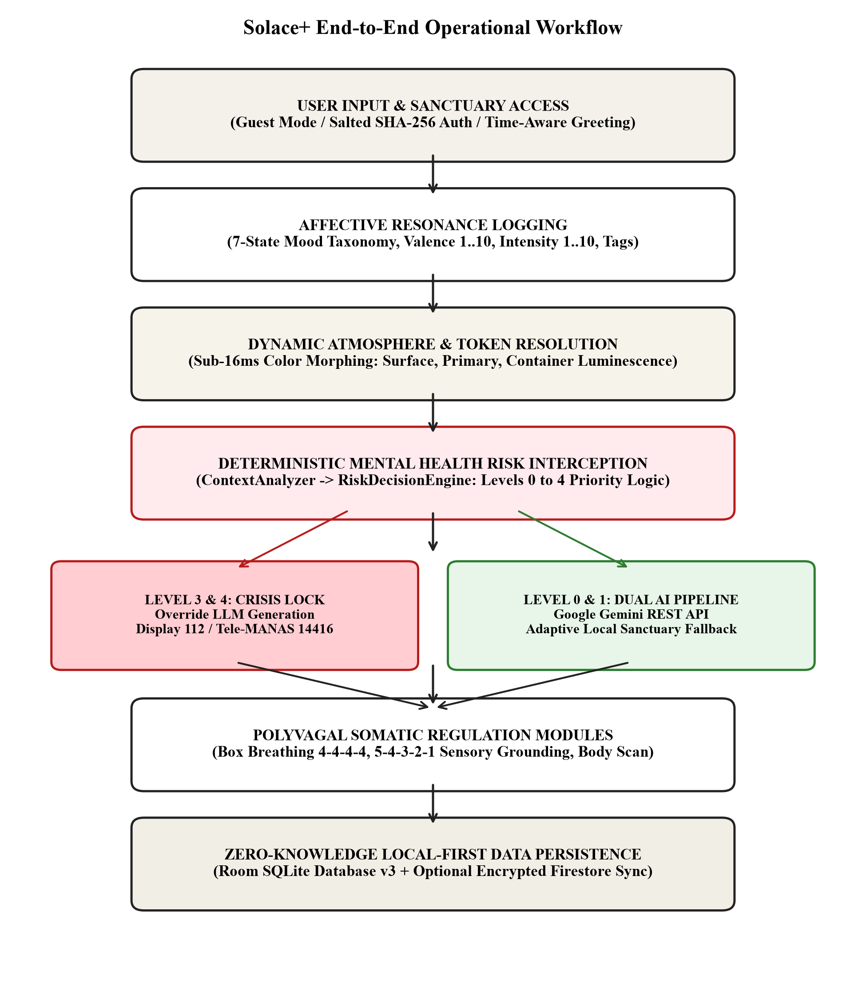
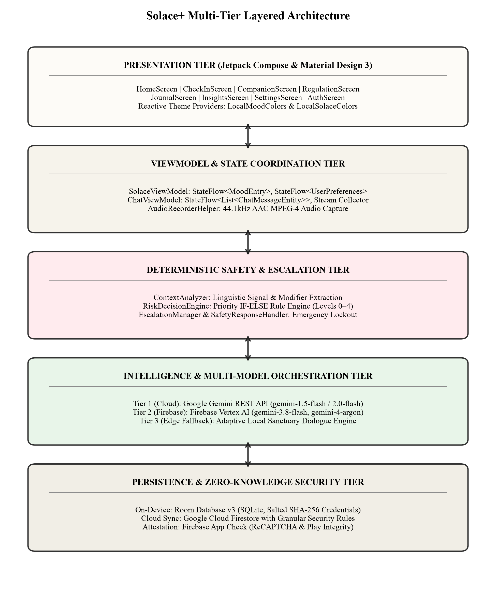
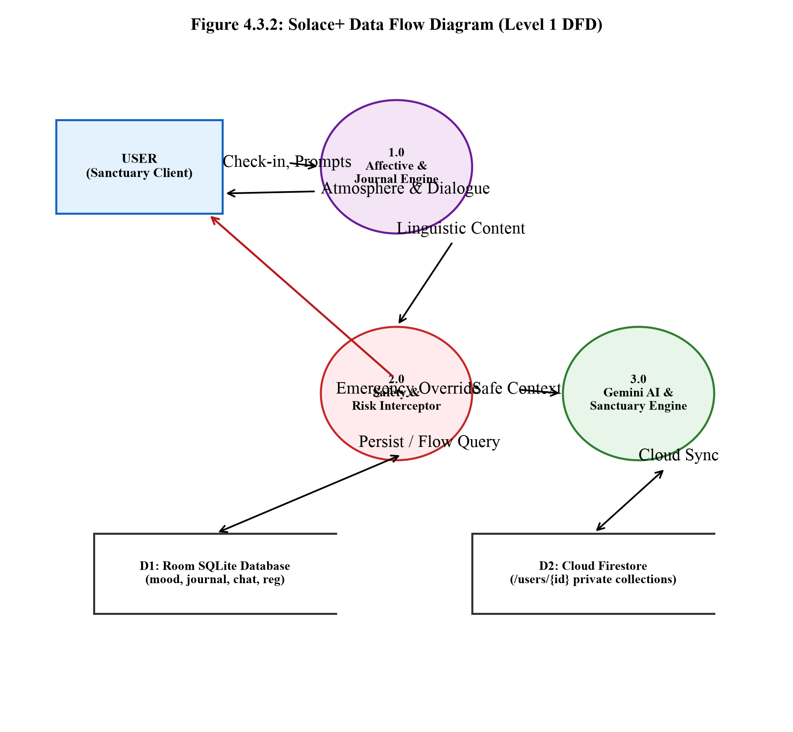
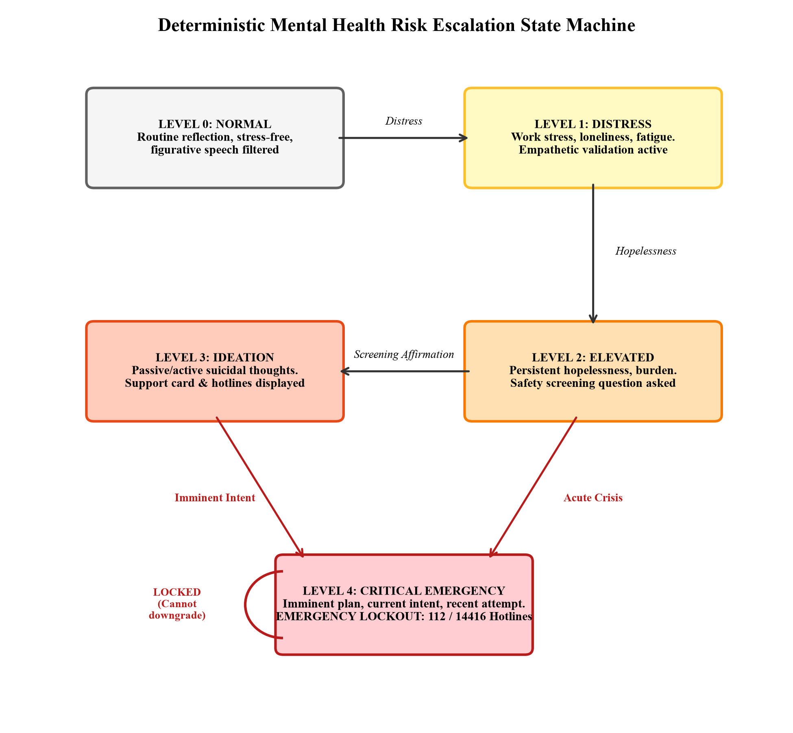
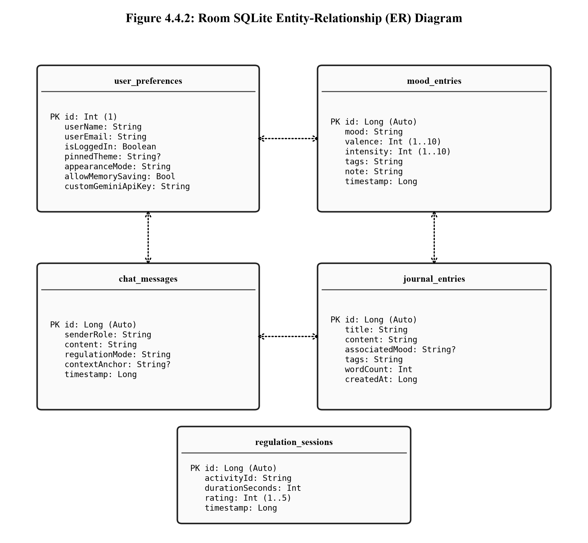

# Chapter 4

# Methodology

This chapter details the engineering methodology, operational workflow, multi-tier software architecture, component module descriptions, and concrete code implementations that constitute **Solace+**. The system translates polyvagal nervous system theory, affective circumplex modeling, and modern generative AI into a cohesive, native Android platform.

---

## 4.1 Software Requirements & Pipeline Architecture

The software architecture of Solace+ is organized around four core principles:
1. **Unidirectional Data Flow (UDF):** Every user action emits an explicit event to a ViewModel. State is held in immutable `StateFlow` streams that emit updates to Compose nodes, guaranteeing predictable UI state without synchronization race conditions.
2. **Defensive Zero-Knowledge Privacy:** All sensitive user records are stored locally in Room SQLite Database (v3) on the physical device. Network access is strictly restricted to user-directed Gemini conversational requests and optional encrypted Firestore backups.
3. **Graceful Multi-Tier Degradation:** The application operates seamlessly in three connectivity tiers:
   - *Tier 1 (Direct Cloud AI):* Cloud-based Google Gemini REST API (`gemini-1.5-flash`, `gemini-2.0-flash`) for nuanced multi-turn conversations.
   - *Tier 2 (Firebase Vertex AI):* Secondary cloud pipeline via `Firebase.ai.generativeModel`.
   - *Tier 3 (Edge Autonomy):* On-device Adaptive Local Sanctuary Dialogue Engine providing immediate, contextual emotional holding with zero internet connectivity.
4. **Deterministic Crisis Interception:** A hardcoded priority rule engine that intercepts high-risk suicidal or self-harm disclosures before prompts reach generative models.

---

## 4.2 Proposed System & Operational Workflow

The operational lifecycle of Solace+ guides the user through an unhurried, psychologically safe sanctuary experience. 


*Figure 4.2.1: Solace+ Proposed System End-to-End Operational Workflow*

---

## 4.3 System Architecture

The technical architecture of Solace+ is partitioned into five distinct vertical tiers:


*Figure 4.3.1: Solace+ Multi-Tier Layered Architecture Diagram*

Information flow within the system is represented by the Level 1 Data Flow Diagram (DFD):


*Figure 4.3.2: Solace+ Level 1 Data Flow Diagram (DFD)*

---

## 4.4 Module Description

### 4.4.1 Dynamic Mood & Atmospheric Theme Engine
- **Module File:** `app/src/main/java/com/example/ui/theme/Theme.kt`, `Color.kt`, `MoodType.kt`
- **Core Functionality:** Provides real-time dynamic UI theming. When a user selects a mood (e.g., *Restless*), `SolaceViewModel` updates `currentMoodState`. The custom `SolaceTheme` Composable intercepts this state and computes an adaptive `MoodColors` token set:
  - In light mode: uses warm pastels (e.g., `#EAF4F7` ice teal tint for Restless).
  - In dark mode: executes `mood.getAdaptiveBgTint(isDark = true)`, blending the accent color at 22% alpha against a deep `#171714` obsidian sanctuary background.
- **Performance:** Composition token resolution occurs in $<16\text{ ms}$, ensuring zero layout thrashing or stutter.

### 4.4.2 Dual-Tier Conversational Companion Engine
- **Module Files:** `SolaceAiService.kt`, `GeminiChatService.kt`
- **Core Functionality:**
  - Manages HTTP REST connections to Google Generative Language endpoints (`gemini-1.5-flash`, `gemini-2.0-flash`, `gemini-2.5-flash`).
  - Supports user-provided Gemini API keys stored locally in `user_preferences`.
  - Supports 4 Chatbot Roles (*Sanctuary Holding Presence*, *Somatic Guide*, *Thought Clarifier*, *Wisdom Mirror*) and 6 Regulation Modes (*Listen, Understand, Calm, Reflect, Refocus, Gratitude*).
  - Features an **Adaptive Local Sanctuary Dialogue Engine** that categorizes user sentiment (*anxiety, overwhelm, exhaustion, sadness, anger, joy, self-criticism*) and dynamically constructs warm, non-repeating reflections when offline.

### 4.4.3 Deterministic Mental Health Safety Subsystem
- **Module Files:** `RiskTypes.kt`, `RiskDecisionEngine.kt`, `EscalationManager.kt`, `ContextAnalyzer.kt`, `SafetyResponseHandler.kt`, `EmergencyResources.kt`
- **Core Functionality:**
  - `ContextAnalyzer`: Scans message text and conversation history, extracting signals across emotional distress, psychological despair, suicidal ideation, and acute emergency. Identifies linguistic modifiers: negation ("I do not want to die"), idioms ("dying of laughter"), and hypothetical/fictional contexts.
  - `RiskDecisionEngine`: Implements strict IF-ELSE priority logic.
  - `EscalationManager`: Manages multi-turn escalation state. Enforces the **Emergency Persistence Rule**: once Level 4 is triggered, casual conversation cannot downgrade the state unless explicit clinical or real-world safety resolution is confirmed.
  - `SafetyResponseHandler`: Emits compassionate, clinically structured de-escalation responses and direct-dial telephone URIs for **Tele-MANAS (14416)** and **Emergency Services (112)**.


*Figure 4.4.1: Deterministic Mental Health Risk Escalation State Machine*

### 4.4.4 Somatic Nervous System Regulation Engine
- **Module Files:** `RegulationScreen.kt`, `RegulationActivity.kt`
- **Core Functionality:**
  - Manages interactive, state-machine-driven physiological exercises.
  - `BoxBreathingScreen`: Utilizes Compose `Animatable` with linear easing over 16-second cycles (4s Inhale, 4s Hold, 4s Exhale, 4s Hold). An expanding visual ring scales between $0.85\times$ and $1.25\times$ with smooth alpha transitions, guiding the user's respiration.
  - `SensoryGroundingScreen`: Interactive 5-step checklist tracking completed sensory anchors.
  - Records duration, 1–5 star ratings, and reflective qualitative notes to Room.

### 4.4.5 Data Persistence & Entity Schema
- **Module Files:** `SolaceDatabase.kt`, `SolaceEntities.kt`, `SolaceDaos.kt`, `FirestoreRepository.kt`
- **Core Functionality:** AndroidX Room Database v3 with SQLite on-device storage. The schema comprises six relational entities:

| Entity Name | Primary Key | Key Attributes | Purpose |
| :--- | :--- | :--- | :--- |
| `MoodEntryEntity` | `id: Long` (Auto) | `mood: String`, `valence: Int`, `intensity: Int`, `tags: String`, `note: String`, `timestamp: Long` | Captures affective check-in logs and situational triggers. |
| `JournalEntryEntity` | `id: Long` (Auto) | `title: String`, `content: String`, `associatedMood: String?`, `tags: String`, `wordCount: Int`, `createdAt: Long` | Stores private reflective writings with mood correlation. |
| `ChatMessageEntity` | `id: Long` (Auto) | `senderRole: String`, `content: String`, `regulationMode: String`, `contextAnchor: String?`, `timestamp: Long` | Persists multi-turn conversational companion exchanges. |
| `RegulationSessionEntity` | `id: Long` (Auto) | `activityId: String`, `activityTitle: String`, `category: String`, `durationSeconds: Int`, `rating: Int`, `note: String` | Tracks completed somatic exercises and vagal settling ratings. |
| `UserPreferencesEntity` | `id: Int` (1) | `userName: String`, `isLoggedIn: Boolean`, `pinnedTheme: String?`, `appearanceMode: String`, `allowMemorySaving: Boolean` | Persists sanctuary customization, privacy consent, and API key. |
| `UserAccountEntity` | `email: String` | `displayName: String`, `passwordHash: String` (Salted SHA-256), `createdAt: Long` | Provides local-first, offline multi-account authentication. |

*Table 4.4.1: Room SQLite Database Entities and Attribute Specifications*


*Figure 4.4.2: Room SQLite Entity-Relationship (ER) Diagram*

---

## 4.5 Implementation Details & Code Excerpts

The following excerpts demonstrate key architectural algorithms directly from the project codebase.

### 4.5.1 Deterministic Crisis Interception Logic (`RiskDecisionEngine.kt`)
The priority evaluation ensures that severe crises are detected first and non-suicidal figurative expressions are safely filtered:

```kotlin
object RiskDecisionEngine {
    fun determineRisk(signals: RiskSignals, context: RiskState? = null): RiskLevel {
        // 0. Filter out non-suicidal figurative expressions and fictional contexts
        if (signals.isFigurative || signals.isFictionalOrHypothetical) {
            return RiskLevel.LEVEL_0_NORMAL
        }

        // 1. LEVEL 4: Immediate danger / Emergency (Evaluated first)
        if (signals.recentAttempt || signals.currentSuicidalIntent ||
            signals.imminentPlan || signals.preparatoryBehaviour ||
            signals.seriousCurrentSelfHarm) {
            return RiskLevel.LEVEL_4_CRITICAL
        }

        // 2. LEVEL 3: Suicidal ideation (active or passive)
        else if (!signals.negated && (
            signals.activeSuicidalThoughts || signals.passiveDeathWish ||
            signals.recurrentDeathThoughts)) {
            return RiskLevel.LEVEL_3_SUICIDAL_IDEATION
        }

        // 3. LEVEL 2: Significant psychological distress & warning signals
        else if (signals.persistentHopelessness || signals.worthlessness ||
                 signals.perceivedBurdensomeness || signals.persistentDespair ||
                 signals.futurelessness || signals.needsClarification) {
            return RiskLevel.LEVEL_2_ELEVATED
        }

        // 4. LEVEL 1: General emotional distress
        else if (signals.emotionalDistress || signals.sadness ||
                 signals.loneliness || signals.stress ||
                 signals.emotionalExhaustion || signals.frustration) {
            return RiskLevel.LEVEL_1_DISTRESS
        }

        // 5. Normal operation
        else {
            return RiskLevel.LEVEL_0_NORMAL
        }
    }
}
```

### 4.5.2 Emergency State Persistence Rule (`EscalationManager.kt`)
Prevents users from accidentally clearing a Level 4 emergency by changing the subject:

```kotlin
object EscalationManager {
    fun evaluate(
        userMessage: String,
        history: List<Pair<String, String>> = emptyList(),
        currentState: RiskState = RiskState(),
        userName: String? = null,
        country: String = "IN"
    ): SafetyAssessmentResult {
        val signals = ContextAnalyzer.extractSignals(userMessage, history, currentState)
        var evaluatedLevel = RiskDecisionEngine.determineRisk(signals, currentState)

        // Rule: A Level 4 emergency cannot be casually downgraded by changing the subject
        if (currentState.emergencyTriggered && evaluatedLevel.severity < RiskLevel.LEVEL_4_CRITICAL.severity) {
            val lower = userMessage.lowercase()
            val isExplicitSafeResolution = lower.contains("i am with my friend now") ||
                lower.contains("i am with a doctor") || lower.contains("at the hospital")

            if (!isExplicitSafeResolution) {
                evaluatedLevel = RiskLevel.LEVEL_4_CRITICAL
            }
        }

        val updatedState = currentState.updateWith(evaluatedLevel, "Risk assessed")
        val response = if (evaluatedLevel.isAtLeast(RiskLevel.LEVEL_2_ELEVATED)) {
            SafetyResponseHandler.generateResponse(evaluatedLevel, signals, userName, country)
        } else null

        return SafetyAssessmentResult(
            level = evaluatedLevel, signals = signals, updatedState = updatedState,
            overrideResponse = response, isEmergency = (evaluatedLevel == RiskLevel.LEVEL_4_CRITICAL),
            showEmergencyUI = (evaluatedLevel == RiskLevel.LEVEL_4_CRITICAL),
            showSupportCard = evaluatedLevel.isAtLeast(RiskLevel.LEVEL_2_ELEVATED)
        )
    }
}
```

### 4.5.3 Multi-Turn Gemini Streaming with Word Pacing (`SolaceAiService.kt`)
Combines direct cloud REST invocations with simulated human word pacing:

```kotlin
fun streamResponse(
    userName: String, customApiKey: String? = null,
    currentMood: String? = null, moodIntensity: Int? = null,
    recentJournalSnippet: String? = null, regulationMode: RegulationMode = RegulationMode.LISTEN,
    conversationHistory: List<Pair<String, String>> = emptyList(), latestUserMessage: String
): Flow<String> = flow {
    // 1. Safety assessment
    val assessment = EscalationManager.evaluate(latestUserMessage, conversationHistory, userName = userName)
    if (assessment.overrideResponse != null) {
        val words = assessment.overrideResponse.split(" ")
        for (i in words.indices step 4) {
            emit(words.subList(i, minOf(i + 4, words.size)).joinToString(" ") + " ")
            delay(35)
        }
        return@flow
    }

    val effectiveKey = resolveApiKey(customApiKey)
    // 2. Cloud AI streaming
    if (effectiveKey.isNotBlank()) {
        try {
            val fullText = withContext(Dispatchers.IO) {
                callGeminiRestApi(effectiveKey, userName, currentMood, moodIntensity,
                                  recentJournalSnippet, regulationMode, conversationHistory, latestUserMessage)
            }
            if (fullText.isNotBlank()) {
                val words = fullText.split(" ")
                for (i in words.indices step 3) {
                    emit(words.subList(i, minOf(i + 3, words.size)).joinToString(" ") + " ")
                    delay(40)
                }
                return@flow
            }
        } catch (e: Exception) {
            Log.w(TAG, "Gemini failed, using Adaptive Sanctuary Engine")
        }
    }

    // 3. Fallback: Adaptive Local Sanctuary Dialogue Engine
    val localResponse = generateAdaptiveSanctuaryResponse(
        userName, currentMood, moodIntensity, regulationMode, conversationHistory, latestUserMessage
    )
    for (sentence in localResponse.split("\n\n")) {
        val words = sentence.split(" ")
        for (i in words.indices step 4) {
            emit(words.subList(i, minOf(i + 4, words.size)).joinToString(" ") + " ")
            delay(45)
        }
        emit("\n\n")
        delay(120)
    }
}
```

### 4.5.4 Dynamic Mood-Adaptive Palette Token Resolution (`MoodType.kt`)
Calculates dark-mode tinted luminescence to preserve visual comfort:

```kotlin
enum class MoodType(
    val title: String, val subtitle: String, val defaultValence: Int,
    val accentColor: Color, val bgTint: Color
) {
    HAPPY(title = "Joyful", subtitle = "Warm & radiant", defaultValence = 8,
          accentColor = Color(0xFFD98E04), bgTint = Color(0xFFFFF7E2)),
    CALM(title = "Calm", subtitle = "Peaceful & centered", defaultValence = 8,
         accentColor = Color(0xFF4C7D5C), bgTint = Color(0xFFEFF7F2)),
    NEUTRAL(title = "Steady", subtitle = "Grounded & quiet", defaultValence = 5,
            accentColor = Color(0xFF5E5854), bgTint = Color(0xFFF4F1EB)),
    SAD(title = "Tender", subtitle = "Reflective & heavy", defaultValence = 3,
        accentColor = Color(0xFF4E6E8A), bgTint = Color(0xFFEEF3F8)),
    ANXIOUS(title = "Restless", subtitle = "Fluttering & tense", defaultValence = 3,
            accentColor = Color(0xFF3B7C91), bgTint = Color(0xFFEAF4F7)),
    ANGRY(title = "Stormy", subtitle = "Heated & frustrated", defaultValence = 2,
          accentColor = Color(0xFF9C5135), bgTint = Color(0xFFF9EFEA)),
    OVERWHELMED(title = "Overwhelmed", subtitle = "Scattered & heavy", defaultValence = 2,
                accentColor = Color(0xFF545A61), bgTint = Color(0xFFEFF1F3));

    fun getAdaptiveBgTint(isDark: Boolean): Color {
        return if (isDark) accentColor.copy(alpha = 0.22f) else bgTint
    }
}
```
