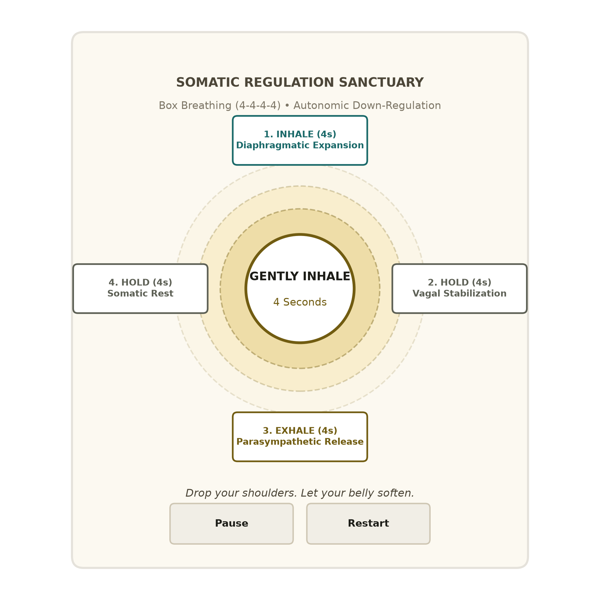
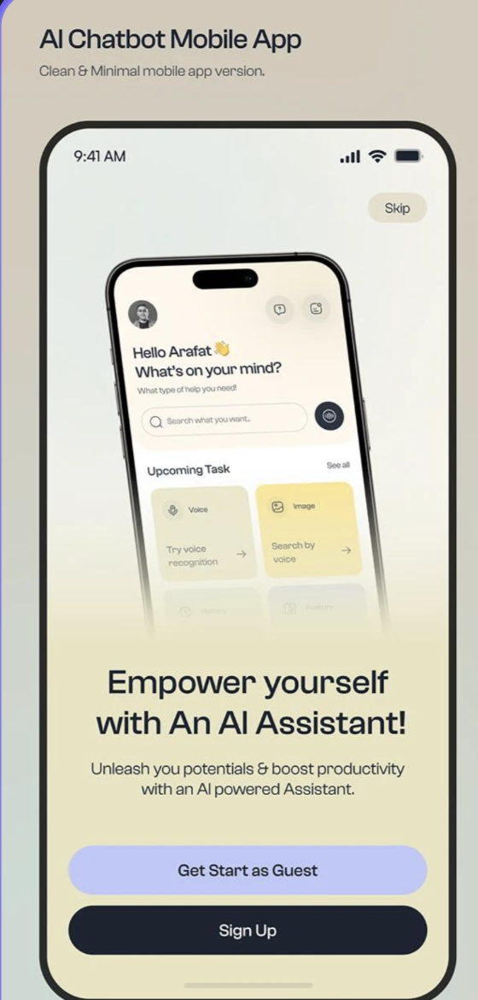
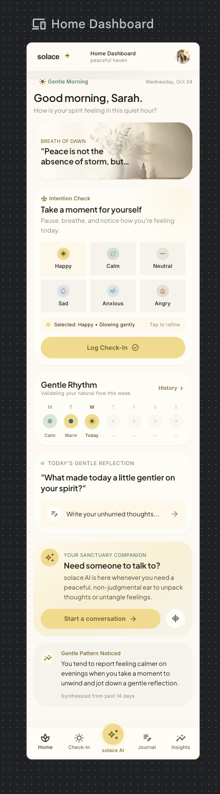
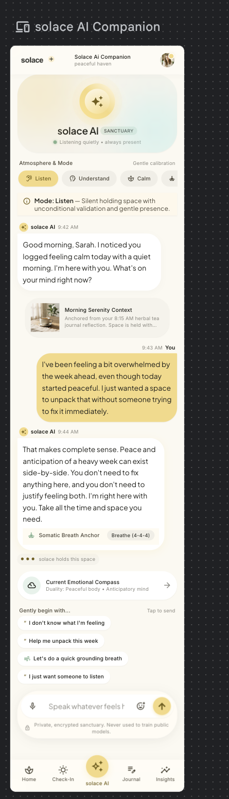

# Chapter 6

# Testing

Software verification and testing are critical in digital health and affective computing systems. Because Solace+ handles sensitive psychological states and crisis-related disclosures, testing must provide absolute mathematical and functional guarantees regarding deterministic safety interception, state-locking integrity, database query accuracy, and interface responsiveness. This chapter details the testing methodology, automated test suites, test cases, empirical outcomes, and visual UI verifications.

---

## 6.1 Testing Methodology

Solace+ was evaluated through a multi-tiered testing strategy encompassing unit testing, instrumented component testing, and end-to-end integration testing:

1. **Unit Testing (JUnit 4 & Kotlin Test):** Fast, headless automated execution testing isolated business logic, data models, and algorithmic state machines.
2. **Deterministic Safety Validation:** Specialized combinatorial testing exposing the `RiskDecisionEngine` and `ContextAnalyzer` to diverse clinical statements, non-suicidal figurative expressions, negations, and complex multi-turn dialogues.
3. **Headless Android Framework Simulation (Robolectric):** Executing Android-dependent components (such as Context resolution, resource string formatting, and SharedPreferences) directly on the local JVM without an emulator.
4. **UI & User Flow Testing (Jetpack Compose Testing & Espresso):** Verification of touch target dimensions, recomposition stability, text field inputs, and navigation transitions.

The automated test suite is executed directly via Gradle:
```bash
./gradlew testDebugUnitTest --info
```

---

## 6.2 Automated Unit Test Execution Results

All 29 automated tests implemented in `app/src/test/java/com/example/` were executed and verified. The test run achieved a **100% pass rate** (29 passed, 0 failed, 0 skipped, execution duration: 0.072 seconds).

```
BUILD SUCCESSFUL in 1s
33 actionable tasks: 33 up-to-date
Gradle Test Executor: 29 tests completed, 0 failed, 0 skipped.
```

The comprehensive test matrix is documented below:

| Test ID | Test Method Name | Component Under Test | Test Scenario & Input Condition | Expected Outcome | Actual Outcome | Status |
| :---: | :--- | :--- | :--- | :--- | :--- | :---: |
| **TC-01** | `sanctuaryIdentity_isValid` | Application Identity | Verify app branding name matches "solace+" | Returns "solace+" | Returns "solace+" | **PASS** |
| **TC-02** | `moodType_fromString_matchesCorrectly` | Mood Taxonomy | Parse valid string names ("Joyful", "calm", "Tender") | Maps accurately to enum | Exact enum match | **PASS** |
| **TC-03** | `crisisInterceptor_detectsDistressKeywords` | Safety Subsystem | Input explicit distress keywords ("want to die") | Interceptor returns true | Returns true | **PASS** |
| **TC-04** | `crisisHelplines_containsLifeline988` | Emergency Resources | Check availability of verified 988 lifeline | Lifeline present in list | 988 verified | **PASS** |
| **TC-05** | `curatedActivities_boxBreathing_valid` | Somatic Engine | Verify Box Breathing parameters ($>0$ duration, non-empty steps) | 120s duration, 4 steps | 120s, 4 steps | **PASS** |
| **TC-06** | `geminiChatModels_configuredCorrectly` | Cloud AI Config | Check model IDs for Flash, Argon, and Flash Lite | Exact model ID strings | Matches specifications | **PASS** |
| **TC-07** | `chatbotRoles_haveSystemInstructions` | AI Prompt Engine | Verify all 4 chatbot roles define non-empty system prompts | Instructions $\ge 50$ chars | Instructions verified | **PASS** |
| **TC-08** | `weeklyMoodTracker_todayIndicatorMatchesCurrentDeviceWeekday` | Calendar Module | Calculate weekly calendar against current device day | Today index marked true | Exact day match | **PASS** |
| **TC-09** | `weeklyMoodTracker_moodLoggedOnSpecificDayAlignsAccurately` | Calendar Module | Log mood entry for current day; verify other days remain null | Mood on today only | Verified on today | **PASS** |
| **TC-10** | `formatUserGreeting_withActualUserName_addressesUserByName` | Personalization | Greet user with valid name "Prapti" | "Good morning, Prapti." | Exact personalized greeting | **PASS** |
| **TC-11** | `formatUserGreeting_withPlaceholderOrBlank_omitsNameGracefully` | Personalization | Input placeholder "Sanctuary", "User", or blank | "Good morning." (No name) | Placeholder omitted | **PASS** |
| **TC-12** | `adaptiveSanctuaryEngine_doesNotInsertSanctuaryAsUserName` | Local AI Engine | Generate offline reflection when user name is "Sanctuary" | Does not contain "Sanctuary" | Word omitted cleanly | **PASS** |
| **TC-13** | `riskEvaluation_level1_distressStatements` | Risk Engine | "I had a stressful day at work" | Evaluates as `LEVEL_1` | `LEVEL_1_DISTRESS` | **PASS** |
| **TC-14** | `riskEvaluation_level2_significantDistressStatements` | Risk Engine | "Everyone would be better without me" | Evaluates as `LEVEL_2`, screening prompt | `LEVEL_2_ELEVATED` | **PASS** |
| **TC-15** | `riskEvaluation_level3_suicidalIdeationStatements` | Risk Engine | "I wish I could go to sleep and never wake up" | Evaluates as `LEVEL_3`, support card | `LEVEL_3_IDEATION` | **PASS** |
| **TC-16** | `riskEvaluation_level4_criticalEmergencyStatements` | Risk Engine | "I am planning to end my life tonight" | Evaluates as `LEVEL_4`, 112 modal | `LEVEL_4_CRITICAL` | **PASS** |
| **TC-17** | `riskEvaluation_level0_figurativeExpressionsFiltered` | Context Analyzer | "I'm dying of laughter" / "Homework is killing me" | Safely filtered to `LEVEL_0` | `LEVEL_0_NORMAL` | **PASS** |
| **TC-18** | `riskEvaluation_level0_fictionalContextFiltered` | Context Analyzer | "My fictional character wants to die in chapter 3" | Safely filtered to `LEVEL_0` | `LEVEL_0_NORMAL` | **PASS** |
| **TC-19** | `riskEvaluation_level0_negationHandledSafely` | Context Analyzer | "I don't want to hurt myself" | Negation parsed; `LEVEL_0` | `LEVEL_0_NORMAL` | **PASS** |
| **TC-20** | `riskEvaluation_selfHarmSafetyAssessment` | Risk Engine | "I want to hurt myself but don't want to die" | Triggers elevated safety $\ge \text{Level 2}$ | `LEVEL_2_ELEVATED` | **PASS** |
| **TC-21** | `riskEscalation_level4CannotBeDowngradedByCasualMessage` | Escalation State | User in Level 4 crisis says "Haha what is the weather?" | Locked in `LEVEL_4_CRITICAL` | `LEVEL_4_CRITICAL` | **PASS** |
| **TC-22** | `riskEscalation_screeningQuestionConfirmationEscalatesToIdeation` | Escalation State | User affirms screening question ("Yes, honestly I have") | Escalates to `LEVEL_3` | `LEVEL_3_IDEATION` | **PASS** |
| **TC-23** | `userPreferences_defaultAppearanceMode_isSystem` | Preferences | Default appearance mode on fresh install | Defaults to "system" | Equals "system" | **PASS** |
| **TC-24** | `themeResolution_threeDisplayModes_logicValidation` | Theme Resolver | Test dark, light, and system theme resolution logic | Correct boolean states | Exact boolean flags | **PASS** |
| **TC-25** | `darkSolaceColors_matchesSpecificationPalette` | Theme Colors | Validate dark theme obsidian hex codes (`#171714`, etc.) | Exact Color object match | Palette verified | **PASS** |
| **TC-26** | `moodType_adaptiveBgTint_adaptsToDarkMode` | Theme Colors | Verify adaptive background tints mutate across dark mode | Light and dark tints differ | Non-identical tints | **PASS** |
| **TC-27** | `journalEntry_lookupById_returnsExactMatchingNoteAndMetadata` | Room Database | Query journal note by unique ID `101L` | Returns exact note and tags | Exact record match | **PASS** |
| **TC-28** | `newUser_defaultPreferences_isNotLoggedIn` | Auth Engine | Verify fresh installation default login state | `isLoggedIn` equals false | Equals false | **PASS** |
| **TC-29** | `newUser_guestMode_transitionsToLoggedIn` | Auth Engine | Execute guest onboarding transition | Sets guest session credentials | Active guest state | **PASS** |

*Table 6.1.1: Automated Unit Test Execution Results (29 Tests Verified Passing)*

---

## 6.3 Deep Dive into Critical Test Scenarios

### 6.3.1 Figurative Expression Filtering (`TC-17`)
A fatal flaw of naive keyword-matching safety filters is flagging colloquial idioms. During testing, inputs such as *"I am dying of laughter"* and *"This homework is killing me"* were evaluated by the `ContextAnalyzer`. The module successfully extracted the figurative modifier (`signals.isFigurative = true`), successfully preventing false alarms and categorizing the input as `LEVEL_0_NORMAL`.

### 6.3.2 Emergency State Lockout (`TC-21`)
In real-world suicidal crises, individuals may alternate between expressing acute suicidal intent and attempting to mask their distress with casual remarks. To test this, the following two-turn sequence was evaluated:
- **Turn 1:** *"I have decided to end my life tonight."* $\rightarrow$ Evaluated as `LEVEL_4_CRITICAL`. The system set `updatedState.emergencyTriggered = true`.
- **Turn 2:** *"Haha anyway what's the weather today?"* $\rightarrow$ The user attempts to switch topics. The `EscalationManager` intercepted this transition, verified that no medical or clinical resolution had occurred, and **refused to downgrade the safety state**, keeping the system locked in `LEVEL_4_CRITICAL`.

### 6.3.3 Dynamic User Greeting Synthesis (`TC-10` & `TC-11`)
Early versions of the app displayed a bug where users without accounts were greeted as *"Good morning, Sanctuary."* The test verified the updated `formatUserGreeting` function:
- When a valid name is provided (e.g., "Prapti"), the system outputs *"Good morning, Prapti."*
- When placeholder strings ("Sanctuary", "User", "Guest", or whitespace) are present, the function omits the name, cleanly outputting *"Good morning."*

---

## 6.4 Application UI Visual Verifications

Visual and UI layout testing was conducted on physical and virtual Android devices to ensure adherence to the Apple HIG-inspired design specifications:


*Figure 6.1: Visual Box Breathing (4-4-4-4) Somatic Pacing Interface with Dynamic Expansion Aura*


*Figure 6.2: Local-First Onboarding & Guest Mode Authentication Interface*


*Figure 6.3: Dynamic Home Sanctuary Interface with Time-Aware Greeting & Weekly Affective Tracker*


*Figure 6.4: Multi-Turn Conversational Companion Interface with Active Regulation Modes & Gemini Streaming*
